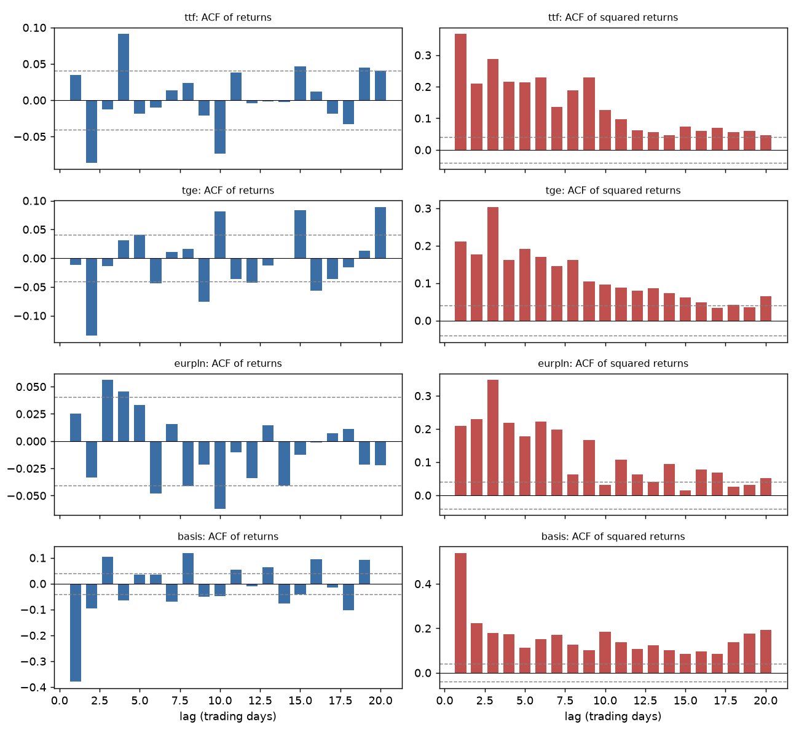

# Stage 2 - Diagnostics report

Generated by `python -m gasrisk.diagnostics` from the Stage 1 panel
(2321 trading days, 2017-10-23 to 2026-11-06).
Significance level 0.05. Every number and verdict below is computed; nothing is typed by hand.

## 1. EUR/PLN source timing

**Question.** Which EUR/PLN source is sampled closest to the TTF settlement?
A source fixed earlier or later than TTF splits the true same-day co-movement
between lag 0 and lags +1 or -1. The **capture ratio** is the lag-0 correlation
divided by the sum of correlations at lags -1, 0 and +1 (a correlation estimate
robust to asynchronous sampling). Closer to 1 means better synchronised.
Intervals come from a moving-block bootstrap.

Lead-lag correlations corr(TTF_t, FX_t+k) and capture ratios:

| source | corr_lag_-3 | corr_lag_-2 | corr_lag_-1 | corr_lag_+0 | corr_lag_+1 | corr_lag_+2 | corr_lag_+3 | lag_summed_corr | capture_ratio | capture_ci_low | capture_ci_high | share_draws_best |
|---|---|---|---|---|---|---|---|---|---|---|---|---|
| nbp | 0.0037 | 0.0050 | 0.0156 | 0.1231 | 0.0996 | 0.0152 | 0.0253 | 0.2383 | 0.5166 | 0.1981 | 0.7272 | 0.0195 |
| ecb | 0.0199 | -0.0170 | 0.0340 | 0.1620 | 0.0453 | 0.0053 | 0.0501 | 0.2413 | 0.6713 | 0.3722 | 0.9447 | 0.8635 |
| yahoo | 0.0191 | 0.0018 | 0.0144 | 0.0933 | 0.0860 | 0.0680 | -0.0063 | 0.1937 | 0.4816 | 0.2431 | 0.8377 | 0.1170 |

Pairwise differences in capture ratio (bootstrap):

- ecb minus nbp: mean 0.165, 95% interval [-0.012, 0.405], ecb higher in 96.8% of draws
- ecb minus yahoo: mean 0.157, 95% interval [-0.227, 0.437], ecb higher in 87.9% of draws

Robustness: crisis sub-period best: **ecb**; TGE as anchor best: **ecb**.

| source | corr_lag_-1 | corr_lag_+0 | corr_lag_+1 | capture_ratio | share_draws_best |
|---|---|---|---|---|---|
| nbp | 0.0137 | 0.1974 | 0.2031 | 0.4767 | 0.0310 |
| ecb | 0.0365 | 0.2513 | 0.1249 | 0.6090 | 0.9075 |
| yahoo | 0.0298 | 0.1336 | 0.1722 | 0.3982 | 0.0615 |

Ordering of FX sources within the day (if A is sampled earlier than B, corr(A_t, B_t-1) > 0):

| pair | corr_x_t_y_t-1 | corr_x_t_y_t | corr_x_t_y_t+1 | sampled_earlier | sampled_later | implied_gap_share | date_offset_suspected |
|---|---|---|---|---|---|---|---|
| nbp vs ecb | 0.3142 | 0.7122 | 0.0073 | nbp | ecb | 0.3061 | False |
| nbp vs yahoo | 0.0117 | 0.6354 | 0.3489 | yahoo | nbp | 0.3544 | False |
| ecb vs yahoo | 0.0162 | 0.3932 | 0.5866 | yahoo | ecb | 0.5987 | True |

- ecb vs yahoo: the lagged correlation (0.587) exceeds the same-day correlation (0.393). The yahoo value dated t is sampled well before the ecb value dated t, i.e. yahoo behaves like a quote taken around the previous evening.

Re-dating the suspected source(s) one day forward and re-testing: best = **ecb** (capture ratios: nbp 0.517, ecb 0.671, yahoo 0.482, yahoo_redated 0.348).

| source | corr_lag_-1 | corr_lag_+0 | corr_lag_+1 | capture_ratio | share_draws_best |
|---|---|---|---|---|---|
| nbp | 0.0156 | 0.1231 | 0.0996 | 0.5166 | 0.0185 |
| ecb | 0.0340 | 0.1620 | 0.0453 | 0.6713 | 0.8410 |
| yahoo | 0.0144 | 0.0933 | 0.0860 | 0.4816 | 0.1165 |
| yahoo_redated | 0.0933 | 0.0860 | 0.0680 | 0.3478 | 0.0240 |

**Selection.** **ecb** has the highest capture ratio (0.671) and is best in
86.4% of bootstrap draws. Its advantage over nbp (not significant at 95%), yahoo (not significant at 95%); the
choice therefore rests on the point estimate together with its consistency across the robustness checks
above, not on a single significance test. It is consistent with published timing: TTF settles around
17:00 CET (ICE Endex), NBP Table A is published between 11:45 and 12:15 Warsaw time, and the ECB rate is
set in the early afternoon CET, the closest of the three to the TTF settlement. **ecb** is the EUR/PLN
risk factor; the other sources (nbp, yahoo) remain cross-checks. The selection matches.

## 2. Series analysed

| series | level | return |
|---|---|---|
| ttf | log roll-adjusted index of the ICE second month held to roll | roll-adjusted log return |
| tge | log TGEgasDA (trade date) | log return, business day to business day |
| eurpln | log EUR/PLN (risk source: ecb) | log return |
| basis | location plus tenor basis (TGE day-ahead spot in EUR minus TTF second month), EUR/MWh | daily change, TTF leg within one contract |

The basis is a **location plus tenor basis**: TGE is a Polish day-ahead spot index, the hedge leg is the
Dutch TTF second-month future. It therefore mixes the Poland-Netherlands location spread with the
spot-versus-forward (tenor) spread, and cannot be read as a pure location basis.

## 3. Stationarity (ADF: H0 unit root; KPSS: H0 stationary)

| series | transform | description | n | adf_stat | adf_p | adf_lags | kpss_stat | kpss_p | kpss_p_note | verdict |
|---|---|---|---|---|---|---|---|---|---|---|
| ttf | level | log roll-adjusted index | 2315 | -1.3889 | 0.5876 | 5 | 0.7238 | 0.0114 |  | unit root |
| ttf | return | log return (roll-adjusted) | 2308 | -14.5994 | 0.0000 | 10 | 0.1685 | 0.1000 | >=0.10 (table bound) | stationary |
| tge | level | log price | 2295 | -1.4449 | 0.5606 | 25 | 2.8582 | 0.0100 | <=0.01 (table bound) | unit root |
| tge | return | log return | 2295 | -10.1683 | 0.0000 | 24 | 0.0459 | 0.1000 | >=0.10 (table bound) | stationary |
| eurpln | level | log rate | 2306 | -2.0661 | 0.2584 | 14 | 1.5870 | 0.0100 | <=0.01 (table bound) | unit root |
| eurpln | return | log return | 2306 | -14.2458 | 0.0000 | 13 | 0.0753 | 0.1000 | >=0.10 (table bound) | stationary |
| basis | level | location plus tenor basis level (EUR/MWh) | 2293 | -5.2429 | 0.0000 | 27 | 0.3041 | 0.1000 | >=0.10 (table bound) | stationary |
| basis | return | location plus tenor basis change (EUR/MWh, roll-adjusted) | 2291 | -11.9898 | 0.0000 | 26 | 0.0224 | 0.1000 | >=0.10 (table bound) | stationary |

Levels: ttf = unit root, tge = unit root, eurpln = unit root, basis = stationary.
Returns / changes: ttf = stationary, tge = stationary, eurpln = stationary, basis = stationary.
KPSS p-values are interpolated from a table and capped at 0.01 and 0.10; capped values are marked.

## 4. Serial dependence

Ljung-Box p-values on returns (mean predictability) and squared returns (volatility clustering), ARCH-LM with 5 lags:

| series | n | lb_ret_p_5 | lb_ret_p_10 | lb_ret_p_20 | robust_q_ret_p_5 | robust_q_ret_p_10 | robust_q_ret_p_20 | lb_sq_p_5 | lb_sq_p_10 | lb_sq_p_20 | arch_lm_stat_5 | arch_lm_p_5 | acf1_ret | acf1_sq |
|---|---|---|---|---|---|---|---|---|---|---|---|---|---|---|
| ttf | 2319 | 0.0000 | 0.0000 | 0.0000 | 0.0434 | 0.0646 | 0.0848 | 0.0000 | 0.0000 | 0.0000 | 444.4056 | 0.0000 | 0.0347 | 0.3671 |
| tge | 2320 | 0.0000 | 0.0000 | 0.0000 | 0.0442 | 0.0113 | 0.0004 | 0.0000 | 0.0000 | 0.0000 | 316.9175 | 0.0000 | -0.0120 | 0.2112 |
| eurpln | 2320 | 0.0021 | 0.0000 | 0.0003 | 0.2750 | 0.0418 | 0.1751 | 0.0000 | 0.0000 | 0.0000 | 388.7592 | 0.0000 | 0.0254 | 0.2099 |
| basis | 2318 | 0.0000 | 0.0000 | 0.0000 | 0.0027 | 0.0040 | 0.0047 | 0.0000 | 0.0000 | 0.0000 | 721.5813 | 0.0000 | -0.3796 | 0.5390 |

- Standard Ljung-Box (assumes i.i.d. returns) rejects no autocorrelation up to lag 10 for: ttf, tge, eurpln, basis.
- The heteroskedasticity-robust portmanteau test (`robust_q_ret_p_*`, valid under volatility clustering) is used for conclusions, because the ARCH results below show the i.i.d. assumption fails. It rejects at every tested lag (5, 10, 20) for: tge, basis; at some lags only (fragile evidence) for: ttf, eurpln; at no lag for: none.
- Series with ARCH effects (ARCH-LM p < 0.05): ttf, tge, eurpln, basis.

Dashed lines are +/- 1.96/sqrt(n) bands, valid only for i.i.d. data; under volatility clustering
they are too narrow for the return ACF, which is why the robust portmanteau test is used above.

## 5. Distribution

| series | unit | n | mean | sd_daily | vol_annualised | skew | excess_kurtosis | jb_stat | jb_p | min | max | share_abs_z_gt_3 | normal_share_abs_z_gt_3 | q01 | q01_normal | q99 | q99_normal |
|---|---|---|---|---|---|---|---|---|---|---|---|---|---|---|---|---|---|
| ttf | log return (roll-adjusted) | 2319 | -0.0000 | 0.0459 | 0.7294 | 0.3347 | 9.5605 | 8832.2494 | 0.0000 | -0.3540 | 0.4071 | 0.0164 | 0.0027 | -0.1217 | -0.1069 | 0.1383 | 0.1069 |
| tge | log return | 2320 | 0.0007 | 0.0657 | 1.0424 | 0.1655 | 16.5910 | 26496.3413 | 0.0000 | -0.7607 | 0.5789 | 0.0207 | 0.0027 | -0.1913 | -0.1521 | 0.2056 | 0.1535 |
| eurpln | log return | 2320 | 0.0000 | 0.0033 | 0.0523 | 0.6316 | 5.7605 | 3345.0818 | 0.0000 | -0.0186 | 0.0235 | 0.0159 | 0.0027 | -0.0085 | -0.0076 | 0.0098 | 0.0077 |
| basis | location plus tenor basis change (EUR/MWh, roll-adjusted) | 2318 | 0.0222 | 4.3881 | 69.6583 | 0.5366 | 46.5408 | 208390.9059 | 0.0000 | -54.5584 | 57.2370 | 0.0224 | 0.0027 | -12.8014 | -10.1860 | 14.4446 | 10.2303 |

- Positive excess kurtosis (fatter tails than normal): ttf, tge, eurpln, basis.
- Normality rejected by Jarque-Bera: ttf, tge, eurpln, basis.
- `share_abs_z_gt_3` is the observed share of days beyond 3 standard deviations; the normal distribution implies `normal_share_abs_z_gt_3`.

### Where the basis tails come from

Basis change = TGE leg (change in TGE in EUR) minus TTF leg (within-contract change in the second month).
On basis tail days (|z| > 3) the size of the two legs is compared:

| metric | value |
|---|---|
| days | 2318.0000 |
| tail_days_abs_z_gt_3 | 52.0000 |
| tail_days_tge_leg_larger | 34.0000 |
| share_tail_days_tge_leg_larger | 0.6538 |
| median_abs_tge_leg_over_abs_basis_tail | 0.7859 |
| median_abs_ttf_leg_over_abs_basis_tail | 0.3440 |
| tge_dominated_tail_days_reversing_next_day | 10.0000 |
| share_tail_sum_sq_of_total | 0.7226 |
| excess_kurtosis_basis_change | 46.5408 |
| excess_kurtosis_tge_leg | 58.4611 |
| excess_kurtosis_ttf_leg | 44.0484 |

The fat tails of the basis come **mainly from TGE spot spikes**, i.e. large moves in the TGE day-ahead leg: the TGE leg is the larger leg on 34 of 52 tail days, and on a typical tail day it is 0.79 of the basis move against 0.34 for the TTF leg (medians). Only 10 of the 34 TGE-dominated tail days reverse by at least half the next day, so most TGE spikes persist for more than one day rather than being one-day blips. The TTF leg is not thin-tailed either (excess kurtosis 44.05 against 58.46 for the TGE leg), so TTF drives the remaining 18 tail days.

## 6. Sub-periods

Sub-period boundaries are a modelling choice set in `config.yaml` (pre-crisis, 2021-2023 crisis, post-crisis).

| series | subperiod | first | last | n | vol_annualised | skew | excess_kurtosis | share_abs_z_gt_3 | jb_p |
|---|---|---|---|---|---|---|---|---|---|
| ttf | pre_crisis | 2017-10-23 | 2021-06-30 | 944 | 0.4774 | 0.2322 | 4.4598 | 0.0117 | 0.0000 |
| ttf | crisis | 2021-07-01 | 2023-06-30 | 516 | 1.1430 | 0.1535 | 4.2758 | 0.0116 | 0.0000 |
| ttf | post_crisis | 2023-07-03 | 2026-11-06 | 859 | 0.6343 | 0.6887 | 7.9703 | 0.0128 | 0.0000 |
| tge | pre_crisis | 2017-10-24 | 2021-06-30 | 943 | 0.9709 | -1.1846 | 29.8102 | 0.0138 | 0.0000 |
| tge | crisis | 2021-07-01 | 2023-06-30 | 517 | 1.5345 | 0.6597 | 5.3031 | 0.0232 | 0.0000 |
| tge | post_crisis | 2023-07-03 | 2026-11-06 | 860 | 0.6963 | 0.8880 | 10.5516 | 0.0151 | 0.0000 |
| eurpln | pre_crisis | 2017-10-24 | 2021-06-30 | 943 | 0.0461 | 0.2623 | 3.7903 | 0.0191 | 0.0000 |
| eurpln | crisis | 2021-07-01 | 2023-06-30 | 517 | 0.0694 | 0.8482 | 4.9536 | 0.0116 | 0.0000 |
| eurpln | post_crisis | 2023-07-03 | 2026-11-06 | 860 | 0.0465 | 0.5002 | 4.3167 | 0.0128 | 0.0000 |
| basis | pre_crisis | 2017-10-24 | 2021-06-30 | 943 | 20.2732 | -7.1039 | 192.4386 | 0.0053 | 0.0000 |
| basis | crisis | 2021-07-01 | 2023-06-30 | 516 | 140.8159 | 0.3295 | 10.2805 | 0.0194 | 0.0000 |
| basis | post_crisis | 2023-07-03 | 2026-11-06 | 859 | 27.3870 | -0.0221 | 3.3337 | 0.0210 | 0.0000 |

## 7. Implications for later stages

- **Volatility models (Stage 4):** ARCH effects in ttf, tge, eurpln, basis support conditional volatility (GARCH) rather than a constant variance.
- **VaR (Stage 5):** fat tails and non-normality in ttf, tge, eurpln, basis mean a normal parametric VaR is expected to understate tail risk; Student-t and filtered historical simulation are the natural alternatives to test.
- **Forecasting (Stage 3):** models are fitted on returns or changes, which are stationary by the joint ADF/KPSS reading where marked above; robust autocorrelation in tge, basis leaves room for ARMA or ML structure to beat the random walk; for ttf, eurpln the evidence of predictable returns is weak or absent, so a random walk is expected to be hard to beat.
- **FX in the book:** the EUR/PLN risk factor is the source selected in section 1; correlations with TTF measured with a mistimed source would be biased toward zero.
