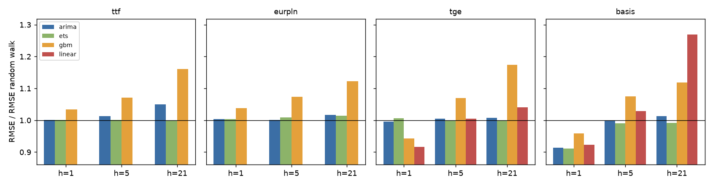

# Stage 3 - Price forecasting report

Generated by `python -m gasrisk.forecasting`. Every number and verdict is computed; nothing is typed by hand.

## Design

- **Targets:** level at t+h for h in [1, 5, 21] business days. TTF, EUR/PLN and TGE are modelled in
  logs, so `rmse` and `mae` are in log points (scale-free) and `rmse_level` is in price units; the basis is
  modelled and evaluated in EUR/MWh.
- **Walk-forward:** rolling 750-day window, parameters re-estimated every 21
  trading days, state updated daily with fixed parameters. A direct h-step model at time T is trained only on
  rows whose target date is on or before T.
- **Models:** random walk (benchmark); ARIMA (ARMA with constant on log returns, or on the basis level;
  order by AIC from [[0, 0], [1, 0], [0, 1], [1, 1], [2, 0], [0, 2]]); ETS (simple vs damped trend, plus weekly seasonal for TGE and
  basis; chosen by AIC); gradient boosting (direct h-step, lag / rolling / cross-asset features);
  `linear` direct regression for TGE and basis (day of week, own reversal, same-day TTF and FX moves, plus an
  error-correction term for TGE). TGE and basis models get day-of-week terms.
- **Tests:** Diebold-Mariano on squared errors against the random walk with the Harvey-Leybourne-Newbold
  correction (`dm_p_better` is the one-sided p-value for "model more accurate"); directional accuracy with
  a one-sided binomial test against 50% (`dir_p`). A random-walk win is a valid finding for prices.

Test window:

| series | h | first_origin | last_origin | first_target | last_target |
|---|---|---|---|---|---|
| basis | 1 | 2020-09-28 | 2026-11-05 | 2020-09-29 | 2026-11-06 |
| basis | 5 | 2020-09-28 | 2026-10-30 | 2020-10-05 | 2026-11-06 |
| basis | 21 | 2020-09-28 | 2026-10-08 | 2020-10-27 | 2026-11-06 |
| eurpln | 1 | 2020-09-28 | 2026-11-05 | 2020-09-29 | 2026-11-06 |
| eurpln | 5 | 2020-09-28 | 2026-10-30 | 2020-10-05 | 2026-11-06 |
| eurpln | 21 | 2020-09-28 | 2026-10-08 | 2020-10-27 | 2026-11-06 |
| tge | 1 | 2020-09-28 | 2026-11-05 | 2020-09-29 | 2026-11-06 |
| tge | 5 | 2020-09-28 | 2026-10-30 | 2020-10-05 | 2026-11-06 |
| tge | 21 | 2020-09-28 | 2026-10-08 | 2020-10-27 | 2026-11-06 |
| ttf | 1 | 2020-09-28 | 2026-11-05 | 2020-09-29 | 2026-11-06 |
| ttf | 5 | 2020-09-28 | 2026-10-30 | 2020-10-05 | 2026-11-06 |
| ttf | 21 | 2020-09-28 | 2026-10-08 | 2020-10-27 | 2026-11-06 |

## Headline

| series | result |
|---|---|
| ttf | 0 of 9 model-horizon pairs beat the random walk at the unadjusted 0.05 level; 0 after Holm adjustment across all comparisons |
| eurpln | 0 of 9 model-horizon pairs beat the random walk at the unadjusted 0.05 level; 0 after Holm adjustment across all comparisons |
| tge | 2 of 12 model-horizon pairs beat the random walk at the unadjusted 0.05 level; 0 after Holm adjustment across all comparisons |
| basis | 0 of 12 model-horizon pairs beat the random walk at the unadjusted 0.05 level; 0 after Holm adjustment across all comparisons |

**Overall.** No model-horizon-series comparisons beat the random walk after Holm adjustment across all 42 comparisons. The strongest raw result is TGE at 1 day (linear: RMSE ratio 0.916, raw DM p 0.0022, Holm p 0.0928). Its gain comes from same-day TTF and FX moves: lagging them one more day leaves 5.9% of the gain. The honest reading is that TGE 1-day changes are partly predictable from same-day TTF information, but the evidence is not strong enough to survive a correction for testing 42 model-horizon-series combinations; for TTF and EUR/PLN the random walk is not beaten, a valid finding for liquid prices.

## TGE and basis - where a model has a real chance

Stage 2 found robust autocorrelation and a mean-reverting basis for these two series, so they get the
most attention: day-of-week terms, a linear direct model with an error-correction term, a step-by-step
ablation of where the predictability comes from, sub-period results and model diagnostics.

### Ablation - which component carries the predictability

The linear direct model is re-run through the full walk-forward with one feature group added at a time.
`dm_p_better_vs_previous_step` tests whether adding the group made forecasts significantly more accurate.

**tge**

| h | step | features | n | rmse_ratio_vs_rw | dm_p_better_vs_rw | dir_acc | dm_p_better_vs_previous_step |
|---|---|---|---|---|---|---|---|
| 1 | day_of_week | 4 | 1570 | 0.9960 | 0.2745 | 0.5369 |  |
| 5 | day_of_week | 4 | 1566 | 1.0044 | 0.8191 | 0.5057 |  |
| 1 | + own reversal | 6 | 1570 | 0.9904 | 0.1284 | 0.5420 | 0.1350 |
| 5 | + own reversal | 6 | 1566 | 1.0081 | 0.9008 | 0.4700 | 0.8213 |
| 1 | + same-day TTF and FX moves | 8 | 1570 | 0.9155 | 0.0006 | 0.6548 | 0.0028 |
| 5 | + same-day TTF and FX moves | 8 | 1566 | 0.9921 | 0.2033 | 0.5600 | 0.0135 |
| 1 | + error-correction term | 9 | 1570 | 0.9163 | 0.0022 | 0.6701 | 0.5228 |
| 5 | + error-correction term | 9 | 1566 | 1.0055 | 0.5621 | 0.5607 | 0.6725 |

At h=1 the largest single improvement comes from **+ same-day TTF and FX moves** (RMSE ratio change -0.075). Steps that significantly improve on the previous one: + same-day TTF and FX moves. Final step: RMSE ratio 0.916, DM p vs random walk 0.0022.

**basis**

| h | step | features | n | rmse_ratio_vs_rw | dm_p_better_vs_rw | dir_acc | dm_p_better_vs_previous_step |
|---|---|---|---|---|---|---|---|
| 1 | mean reversion (level) | 1 | 1570 | 1.1283 | 0.9607 | 0.5592 |  |
| 5 | mean reversion (level) | 1 | 1566 | 1.0522 | 0.6709 | 0.5881 |  |
| 1 | + day_of_week | 5 | 1570 | 1.1254 | 0.9578 | 0.6000 | 0.1006 |
| 5 | + day_of_week | 5 | 1566 | 1.0533 | 0.6734 | 0.5843 | 0.9728 |
| 1 | + own reversal | 7 | 1570 | 0.9386 | 0.1563 | 0.6389 | 0.0000 |
| 5 | + own reversal | 7 | 1566 | 1.0415 | 0.7415 | 0.6201 | 0.4625 |
| 1 | + same-day TTF and FX moves | 9 | 1570 | 0.9226 | 0.0870 | 0.6541 | 0.0243 |
| 5 | + same-day TTF and FX moves | 9 | 1566 | 1.0283 | 0.6754 | 0.6533 | 0.0795 |

At h=1 the largest single improvement comes from **+ own reversal** (RMSE ratio change -0.187). Steps that significantly improve on the previous one: + own reversal, + same-day TTF and FX moves. Final step: RMSE ratio 0.923, DM p vs random walk 0.0870.

### TGE - TGEgasDA, trade date (PLN/MWh)

- h=1: **linear beats the random walk at the unadjusted 5% level, but not after Holm adjustment for multiple testing** (RMSE ratio 0.916, DM one-sided p 0.0022, Holm-adjusted p across all comparisons 0.0928, directional accuracy 0.670, binomial p 0.0000).
- h=5: **random walk not beaten.** Lowest RMSE: ets (ratio 1.000, DM one-sided p 0.4896); no model is significantly more accurate at the 0.05 level.
- h=21: **random walk not beaten.** Lowest RMSE: ets (ratio 1.000, DM one-sided p 0.5773); no model is significantly more accurate at the 0.05 level.

**h = 1**

| model | n | rmse | rmse_ratio_vs_rw | mae | rmse_level | dir_acc | dir_p | dm_stat | dm_p_better | verdict |
|---|---|---|---|---|---|---|---|---|---|---|
| random_walk | 1570 | 0.0657 | 1.0000 | 0.0413 | 31.6649 |  |  |  |  | benchmark |
| arima | 1570 | 0.0654 | 0.9961 | 0.0420 | 31.2846 | 0.5357 | 0.0025 | -0.5046 | 0.3070 | no significant difference |
| ets | 1570 | 0.0661 | 1.0063 | 0.0422 | 31.4935 | 0.5204 | 0.0559 | 0.9503 | 0.8290 | no significant difference |
| gbm | 1570 | 0.0620 | 0.9433 | 0.0381 | 30.6046 | 0.6573 | 0.0000 | -2.8198 | 0.0024 | beats random walk |
| linear | 1570 | 0.0602 | 0.9163 | 0.0372 | 28.7381 | 0.6701 | 0.0000 | -2.8508 | 0.0022 | beats random walk |

**h = 5**

| model | n | rmse | rmse_ratio_vs_rw | mae | rmse_level | dir_acc | dir_p | dm_stat | dm_p_better | verdict |
|---|---|---|---|---|---|---|---|---|---|---|
| random_walk | 1566 | 0.1415 | 1.0000 | 0.0943 | 70.5363 |  |  |  |  | benchmark |
| arima | 1566 | 0.1421 | 1.0046 | 0.0955 | 70.4328 | 0.4783 | 0.9594 | 0.6320 | 0.7363 | no significant difference |
| ets | 1566 | 0.1415 | 1.0000 | 0.0943 | 70.5422 | 0.4815 | 0.9320 | -0.0260 | 0.4896 | no significant difference |
| gbm | 1566 | 0.1513 | 1.0695 | 0.1008 | 78.4263 | 0.5153 | 0.1175 | 2.2640 | 0.9881 | worse than random walk |
| linear | 1566 | 0.1422 | 1.0055 | 0.0936 | 72.3411 | 0.5607 | 0.0000 | 0.1563 | 0.5621 | no significant difference |

**h = 21**

| model | n | rmse | rmse_ratio_vs_rw | mae | rmse_level | dir_acc | dir_p | dm_stat | dm_p_better | verdict |
|---|---|---|---|---|---|---|---|---|---|---|
| random_walk | 1550 | 0.2814 | 1.0000 | 0.1910 | 132.6267 |  |  |  |  | benchmark |
| arima | 1550 | 0.2837 | 1.0082 | 0.1943 | 136.9420 | 0.5006 | 0.4899 | 0.3530 | 0.6379 | no significant difference |
| ets | 1550 | 0.2815 | 1.0003 | 0.1913 | 132.5191 | 0.4768 | 0.9682 | 0.1949 | 0.5773 | no significant difference |
| gbm | 1550 | 0.3305 | 1.1744 | 0.2278 | 162.1138 | 0.4471 | 1.0000 | 2.0636 | 0.9804 | worse than random walk |
| linear | 1550 | 0.2928 | 1.0405 | 0.2008 | 155.7172 | 0.5006 | 0.4899 | 0.5194 | 0.6982 | no significant difference |

**Linear model with error-correction term (in-sample, descriptive, full sample, HAC errors).** One-day change
in log TGE on the log ratio of TGE (EUR) to TTF and controls:

| term | coef | hac_se | t | p |
|---|---|---|---|---|
| const | 0.0060 | 0.0035 | 1.7344 | 0.0828 |
| dow_1 | 0.0031 | 0.0042 | 0.7326 | 0.4638 |
| dow_2 | -0.0023 | 0.0035 | -0.6418 | 0.5210 |
| dow_3 | -0.0262 | 0.0036 | -7.2932 | 0.0000 |
| dow_4 | 0.0161 | 0.0037 | 4.3512 | 0.0000 |
| tge_chg | -0.1649 | 0.0474 | -3.4822 | 0.0005 |
| tge_chg_lag1 | -0.1088 | 0.0386 | -2.8155 | 0.0049 |
| ttf_chg | 0.5571 | 0.0595 | 9.3639 | 0.0000 |
| eurpln_chg | 0.2605 | 0.4086 | 0.6376 | 0.5237 |
| z_tge_ttf | -0.0488 | 0.0255 | -1.9094 | 0.0562 |
| implied_half_life_days | 13.8671 |  |  |  |
| r_squared | 0.2092 |  |  |  |
| n | 2318.0000 |  |  |  |

The coefficient on `z_tge_ttf` is -0.0488 (HAC t -1.91):
no significant pull toward TTF x EUR/PLN at this horizon.
Terms with the largest |HAC t| (excluding the constant): ttf_chg (9.36), dow_3 (7.29), dow_4 (4.35), tge_chg (3.48).
The ablation above shows how much of this survives out of sample.

**Gradient boosting permutation importance (TGE, h=1, last window):**

| feature | importance_mean | importance_sd |
|---|---|---|
| z_tge_ttf | 0.2461 | 0.0147 |
| ttf_chg | 0.1159 | 0.0144 |
| own_sum21 | 0.0660 | 0.0101 |
| own_sd63 | 0.0635 | 0.0056 |
| z_chg5 | 0.0616 | 0.0085 |
| dow | 0.0591 | 0.0052 |
| own_chg_lag1 | 0.0499 | 0.0056 |
| eurpln_chg | 0.0477 | 0.0057 |
| own_sd5 | 0.0294 | 0.0032 |
| eurpln_sum5 | 0.0245 | 0.0025 |

### Basis - location plus tenor basis: TGE day-ahead spot (EUR) minus TTF second month (EUR/MWh)

- h=1: **random walk not beaten.** Lowest RMSE: ets (ratio 0.911, DM one-sided p 0.0729); no model is significantly more accurate at the 0.05 level.
- h=5: **random walk not beaten.** Lowest RMSE: ets (ratio 0.990, DM one-sided p 0.4287); no model is significantly more accurate at the 0.05 level.
- h=21: **random walk not beaten.** Lowest RMSE: ets (ratio 0.992, DM one-sided p 0.1750); no model is significantly more accurate at the 0.05 level.

**h = 1**

| model | n | rmse | rmse_ratio_vs_rw | mae | rmse_level | dir_acc | dir_p | dm_stat | dm_p_better | verdict |
|---|---|---|---|---|---|---|---|---|---|---|
| random_walk | 1570 | 5.2384 | 1.0000 | 2.4582 | 5.2384 |  |  |  |  | benchmark |
| arima | 1570 | 4.7880 | 0.9140 | 2.2425 | 4.7880 | 0.6325 | 0.0000 | -1.3616 | 0.0868 | no significant difference |
| ets | 1570 | 4.7704 | 0.9107 | 2.2415 | 4.7704 | 0.6363 | 0.0000 | -1.4550 | 0.0729 | no significant difference |
| gbm | 1570 | 5.0250 | 0.9593 | 2.3371 | 5.0250 | 0.6274 | 0.0000 | -1.3528 | 0.0882 | no significant difference |
| linear | 1570 | 4.8328 | 0.9226 | 2.2288 | 4.8328 | 0.6541 | 0.0000 | -1.3601 | 0.0870 | no significant difference |

**h = 5**

| model | n | rmse | rmse_ratio_vs_rw | mae | rmse_level | dir_acc | dir_p | dm_stat | dm_p_better | verdict |
|---|---|---|---|---|---|---|---|---|---|---|
| random_walk | 1566 | 6.7501 | 1.0000 | 3.2284 | 6.7501 |  |  |  |  | benchmark |
| arima | 1566 | 6.7382 | 0.9982 | 3.0314 | 6.7382 | 0.6201 | 0.0000 | -0.0338 | 0.4865 | no significant difference |
| ets | 1566 | 6.6849 | 0.9903 | 3.0248 | 6.6849 | 0.6290 | 0.0000 | -0.1798 | 0.4287 | no significant difference |
| gbm | 1566 | 7.2527 | 1.0745 | 3.2877 | 7.2527 | 0.6360 | 0.0000 | 1.1595 | 0.8768 | no significant difference |
| linear | 1566 | 6.9411 | 1.0283 | 3.0559 | 6.9411 | 0.6533 | 0.0000 | 0.4549 | 0.6754 | no significant difference |

**h = 21**

| model | n | rmse | rmse_ratio_vs_rw | mae | rmse_level | dir_acc | dir_p | dm_stat | dm_p_better | verdict |
|---|---|---|---|---|---|---|---|---|---|---|
| random_walk | 1550 | 12.6469 | 1.0000 | 5.0658 | 12.6469 |  |  |  |  | benchmark |
| arima | 1550 | 12.8086 | 1.0128 | 5.1447 | 12.8086 | 0.5813 | 0.0000 | 0.2382 | 0.5941 | no significant difference |
| ets | 1550 | 12.5448 | 0.9919 | 4.8955 | 12.5448 | 0.5729 | 0.0000 | -0.9349 | 0.1750 | no significant difference |
| gbm | 1550 | 14.1395 | 1.1180 | 5.6337 | 14.1395 | 0.5748 | 0.0000 | 1.2365 | 0.8918 | no significant difference |
| linear | 1550 | 16.0441 | 1.2686 | 6.2348 | 16.0441 | 0.5671 | 0.0000 | 1.2106 | 0.8869 | no significant difference |

**AR(1) on the basis level (in-sample, descriptive, HAC errors):**

| metric | value |
|---|---|
| phi | 0.8991 |
| phi_hac_se | 0.0397 |
| implied_half_life_days | 6.5183 |
| long_run_mean_eur_mwh | 1.2364 |
| n | 2320.0000 |

Implied half-life of basis shocks: 6.5 trading days around a long-run mean of
1.24 EUR/MWh.

**Gradient boosting permutation importance (basis, h=1, last window):**

| feature | importance_mean | importance_sd |
|---|---|---|
| ttf_chg | 0.1352 | 0.0137 |
| own_sum5 | 0.0830 | 0.0085 |
| own_chg_lag0 | 0.0641 | 0.0071 |
| dow | 0.0639 | 0.0033 |
| own_chg_lag1 | 0.0625 | 0.0072 |
| level | 0.0526 | 0.0076 |
| own_sd21 | 0.0314 | 0.0039 |
| own_sd5 | 0.0312 | 0.0048 |
| own_chg_lag2 | 0.0281 | 0.0031 |
| z_tge_ttf | 0.0241 | 0.0032 |

### Sub-periods (RMSE ratio vs random walk, by target date)

| series | h | model | pre_crisis | crisis | post_crisis |
|---|---|---|---|---|---|
| basis | 1 | arima | 0.9993 | 0.9104 | 0.9651 |
| basis | 1 | ets | 0.9850 | 0.9052 | 0.9884 |
| basis | 1 | gbm | 0.9343 | 0.9513 | 1.0758 |
| basis | 1 | linear | 0.9387 | 0.9201 | 0.9592 |
| basis | 5 | arima | 0.9895 | 1.0036 | 0.9369 |
| basis | 5 | ets | 0.9764 | 0.9912 | 0.9811 |
| basis | 5 | gbm | 1.3136 | 1.0832 | 0.9610 |
| basis | 5 | linear | 0.9324 | 1.0349 | 0.9558 |
| basis | 21 | arima | 1.2682 | 1.0120 | 1.0251 |
| basis | 21 | ets | 0.9787 | 0.9923 | 0.9815 |
| basis | 21 | gbm | 1.1375 | 1.1196 | 1.0764 |
| basis | 21 | linear | 1.0593 | 1.2703 | 1.2294 |
| tge | 1 | arima | 1.0259 | 0.9956 | 0.9922 |
| tge | 1 | ets | 1.0468 | 1.0044 | 1.0045 |
| tge | 1 | gbm | 0.9612 | 0.9347 | 0.9646 |
| tge | 1 | linear | 0.9682 | 0.9024 | 0.9462 |
| tge | 5 | arima | 0.9881 | 1.0082 | 0.9968 |
| tge | 5 | ets | 0.9965 | 1.0002 | 1.0000 |
| tge | 5 | gbm | 1.0855 | 1.0887 | 1.0089 |
| tge | 5 | linear | 1.0000 | 1.0094 | 0.9951 |
| tge | 21 | arima | 0.9587 | 1.0134 | 0.9921 |
| tge | 21 | ets | 1.0052 | 1.0001 | 1.0000 |
| tge | 21 | gbm | 1.2568 | 1.1717 | 1.1700 |
| tge | 21 | linear | 1.1108 | 1.0332 | 1.0612 |

## TTF and EUR/PLN - random walk benchmark

For liquid futures and FX, a random walk that is hard to beat is the expected and valid result: Stage 2
found only weak (lag-dependent) autocorrelation once volatility clustering is accounted for.

### TTF - TTF second month held to roll (EUR/MWh)

- h=1: **random walk not beaten.** Lowest RMSE: ets (ratio 1.001, DM one-sided p 0.6047); no model is significantly more accurate at the 0.05 level.
- h=5: **random walk not beaten.** Lowest RMSE: ets (ratio 1.000, DM one-sided p 0.5225); no model is significantly more accurate at the 0.05 level.
- h=21: **random walk not beaten.** Lowest RMSE: ets (ratio 0.998, DM one-sided p 0.4407); no model is significantly more accurate at the 0.05 level.

**h = 1**

| model | n | rmse | rmse_ratio_vs_rw | mae | rmse_level | dir_acc | dir_p | dm_stat | dm_p_better | verdict |
|---|---|---|---|---|---|---|---|---|---|---|
| random_walk | 1570 | 0.0522 | 1.0000 | 0.0357 | 2.0090 |  |  |  |  | benchmark |
| arima | 1570 | 0.0523 | 1.0012 | 0.0360 | 1.9801 | 0.5058 | 0.3337 | 0.1486 | 0.5590 | no significant difference |
| ets | 1570 | 0.0523 | 1.0005 | 0.0357 | 2.0110 | 0.5320 | 0.0061 | 0.2657 | 0.6047 | no significant difference |
| gbm | 1570 | 0.0540 | 1.0336 | 0.0375 | 1.9919 | 0.5045 | 0.3712 | 2.5138 | 0.9940 | worse than random walk |

**h = 5**

| model | n | rmse | rmse_ratio_vs_rw | mae | rmse_level | dir_acc | dir_p | dm_stat | dm_p_better | verdict |
|---|---|---|---|---|---|---|---|---|---|---|
| random_walk | 1566 | 0.1154 | 1.0000 | 0.0799 | 4.6766 |  |  |  |  | benchmark |
| arima | 1566 | 0.1168 | 1.0125 | 0.0817 | 4.7017 | 0.4591 | 0.9994 | 2.7891 | 0.9973 | worse than random walk |
| ets | 1566 | 0.1154 | 1.0004 | 0.0796 | 4.7036 | 0.5288 | 0.0122 | 0.0566 | 0.5225 | no significant difference |
| gbm | 1566 | 0.1236 | 1.0710 | 0.0869 | 4.7028 | 0.5141 | 0.1384 | 2.5708 | 0.9949 | worse than random walk |

**h = 21**

| model | n | rmse | rmse_ratio_vs_rw | mae | rmse_level | dir_acc | dir_p | dm_stat | dm_p_better | verdict |
|---|---|---|---|---|---|---|---|---|---|---|
| random_walk | 1550 | 0.2360 | 1.0000 | 0.1787 | 8.6333 |  |  |  |  | benchmark |
| arima | 1550 | 0.2477 | 1.0496 | 0.1882 | 9.0095 | 0.4290 | 1.0000 | 2.5913 | 0.9952 | worse than random walk |
| ets | 1550 | 0.2355 | 0.9980 | 0.1774 | 8.7670 | 0.5110 | 0.2010 | -0.1492 | 0.4407 | no significant difference |
| gbm | 1550 | 0.2738 | 1.1603 | 0.2088 | 10.1322 | 0.4910 | 0.7693 | 2.3019 | 0.9893 | worse than random walk |

### EUR/PLN - EUR/PLN (ECB)

- h=1: **random walk not beaten.** Lowest RMSE: ets (ratio 1.004, DM one-sided p 0.9709); no model is significantly more accurate at the 0.05 level.
- h=5: **random walk not beaten.** Lowest RMSE: arima (ratio 1.001, DM one-sided p 0.5832); no model is significantly more accurate at the 0.05 level.
- h=21: **random walk not beaten.** Lowest RMSE: ets (ratio 1.015, DM one-sided p 0.9990); no model is significantly more accurate at the 0.05 level.

**h = 1**

| model | n | rmse | rmse_ratio_vs_rw | mae | rmse_level | dir_acc | dir_p | dm_stat | dm_p_better | verdict |
|---|---|---|---|---|---|---|---|---|---|---|
| random_walk | 1570 | 0.0035 | 1.0000 | 0.0025 | 0.0161 |  |  |  |  | benchmark |
| arima | 1570 | 0.0036 | 1.0039 | 0.0025 | 0.0161 | 0.5244 | 0.0286 | 1.0744 | 0.8586 | no significant difference |
| ets | 1570 | 0.0036 | 1.0039 | 0.0025 | 0.0161 | 0.5193 | 0.0674 | 1.8952 | 0.9709 | worse than random walk |
| gbm | 1570 | 0.0037 | 1.0381 | 0.0026 | 0.0167 | 0.5244 | 0.0286 | 4.4274 | 1.0000 | worse than random walk |

**h = 5**

| model | n | rmse | rmse_ratio_vs_rw | mae | rmse_level | dir_acc | dir_p | dm_stat | dm_p_better | verdict |
|---|---|---|---|---|---|---|---|---|---|---|
| random_walk | 1566 | 0.0080 | 1.0000 | 0.0055 | 0.0363 |  |  |  |  | benchmark |
| arima | 1566 | 0.0080 | 1.0011 | 0.0055 | 0.0363 | 0.5010 | 0.4798 | 0.2102 | 0.5832 | no significant difference |
| ets | 1566 | 0.0080 | 1.0091 | 0.0056 | 0.0366 | 0.5394 | 0.0010 | 2.4692 | 0.9932 | worse than random walk |
| gbm | 1566 | 0.0085 | 1.0737 | 0.0060 | 0.0389 | 0.5048 | 0.3615 | 4.7657 | 1.0000 | worse than random walk |

**h = 21**

| model | n | rmse | rmse_ratio_vs_rw | mae | rmse_level | dir_acc | dir_p | dm_stat | dm_p_better | verdict |
|---|---|---|---|---|---|---|---|---|---|---|
| random_walk | 1550 | 0.0150 | 1.0000 | 0.0111 | 0.0685 |  |  |  |  | benchmark |
| arima | 1550 | 0.0153 | 1.0172 | 0.0114 | 0.0697 | 0.4887 | 0.8198 | 1.4182 | 0.9218 | no significant difference |
| ets | 1550 | 0.0153 | 1.0148 | 0.0113 | 0.0696 | 0.4855 | 0.8788 | 3.0906 | 0.9990 | worse than random walk |
| gbm | 1550 | 0.0169 | 1.1228 | 0.0133 | 0.0765 | 0.4719 | 0.9873 | 3.3573 | 0.9996 | worse than random walk |

### Sub-periods

| series | h | model | pre_crisis | crisis | post_crisis |
|---|---|---|---|---|---|
| eurpln | 1 | arima | 0.9947 | 1.0067 | 1.0031 |
| eurpln | 1 | ets | 1.0053 | 1.0066 | 0.9998 |
| eurpln | 1 | gbm | 1.0601 | 1.0249 | 1.0483 |
| eurpln | 5 | arima | 1.0026 | 0.9993 | 1.0031 |
| eurpln | 5 | ets | 1.0242 | 1.0108 | 0.9999 |
| eurpln | 5 | gbm | 1.1098 | 1.0548 | 1.0869 |
| eurpln | 21 | arima | 1.0257 | 1.0126 | 1.0206 |
| eurpln | 21 | ets | 1.0598 | 1.0145 | 1.0001 |
| eurpln | 21 | gbm | 1.1444 | 1.0893 | 1.1586 |
| ttf | 1 | arima | 1.0122 | 0.9949 | 1.0114 |
| ttf | 1 | ets | 1.0008 | 1.0000 | 1.0015 |
| ttf | 1 | gbm | 1.0183 | 1.0190 | 1.0640 |
| ttf | 5 | arima | 1.0538 | 1.0126 | 1.0055 |
| ttf | 5 | ets | 1.0013 | 1.0002 | 1.0007 |
| ttf | 5 | gbm | 1.1015 | 1.0622 | 1.0844 |
| ttf | 21 | arima | 1.1939 | 1.0467 | 1.0284 |
| ttf | 21 | ets | 0.9945 | 0.9975 | 0.9998 |
| ttf | 21 | gbm | 1.3237 | 1.1203 | 1.2154 |

## Robustness checks

### 1. Leakage

Timing at the forecast origin (after the close of day t):

| input | observed | used at row t |
|---|---|---|
| TGEgasDA, trade date t | volume weighted price of trades on day t | yes |
| TTF second-month settlement, day t | around 17:00 CET on day t | yes |
| ECB EUR/PLN, day t | early afternoon CET on day t | yes |
| any value dated t+1 or later | after the origin | never |
| target (TGE, h=1) | trade date t+1 | as target only |

Mechanical tests (`tests/test_leakage.py`): every feature and target value up to row t is unchanged
when all data after t are replaced; every model's walk-forward forecast at origin t is unchanged when
data after t are replaced (random walk, ARIMA, ETS, gradient boosting, linear); target dates are exactly
h rows after the origin; same-day TTF and FX inputs at t are used, and the placebo lag removes them.

### 2. Placebo: TTF and FX lagged one more day

All TTF- and FX-derived inputs of the TGE and basis models (changes, 5-day sums, the TGE/TTF ratio) are
lagged by one extra day; TGE's own inputs and the targets are unchanged.

| series | h | model | n | rmse_ratio_original | rmse_ratio_placebo | dm_p_better_original | dm_p_better_placebo | gain_surviving |
|---|---|---|---|---|---|---|---|---|
| tge | 1 | linear | 1570 | 0.9163 | 0.9950 | 0.0022 | 0.3374 | 0.0595 |
| tge | 1 | gbm | 1570 | 0.9433 | 1.0270 | 0.0024 | 0.9790 | -0.4753 |
| tge | 5 | linear | 1566 | 1.0055 | 1.0224 | 0.5621 | 0.8046 |  |
| tge | 5 | gbm | 1566 | 1.0695 | 1.0893 | 0.9881 | 0.9982 |  |
| basis | 1 | linear | 1570 | 0.9226 | 0.9200 | 0.0870 | 0.0918 | 1.0333 |
| basis | 1 | gbm | 1570 | 0.9593 | 0.9657 | 0.0882 | 0.1161 | 0.8413 |
| basis | 5 | linear | 1566 | 1.0283 | 1.0449 | 0.6754 | 0.7503 |  |
| basis | 5 | gbm | 1566 | 1.0745 | 1.0868 | 0.8768 | 0.8866 |  |

- tge linear, h=1: RMSE ratio 0.916 -> 0.995 with TTF and FX lagged one more day; DM p vs random walk 0.0022 -> 0.3374; share of the gain surviving: 5.9%.
- tge gbm, h=1: RMSE ratio 0.943 -> 1.027 with TTF and FX lagged one more day; DM p vs random walk 0.0024 -> 0.9790; share of the gain surviving: -47.5%.
- basis linear, h=1: RMSE ratio 0.923 -> 0.920 with TTF and FX lagged one more day; DM p vs random walk 0.0870 -> 0.0918; share of the gain surviving: 103.3%.
- basis gbm, h=1: RMSE ratio 0.959 -> 0.966 with TTF and FX lagged one more day; DM p vs random walk 0.0882 -> 0.1161; share of the gain surviving: 84.1%.

### 3. Multiple testing (Holm)

Ten smallest one-sided DM p-values with Holm adjustments (full table in `outputs/stage3_metrics.csv`):

| series | h | model | dm_p_better | holm_p_all | holm_p_prespecified |
|---|---|---|---|---|---|
| tge | 1 | linear | 0.0022 | 0.0928 | 0.0530 |
| tge | 1 | gbm | 0.0024 | 0.0998 | 0.0560 |
| basis | 1 | ets | 0.0729 | 1.0000 | 1.0000 |
| basis | 1 | arima | 0.0868 | 1.0000 | 1.0000 |
| basis | 1 | linear | 0.0870 | 1.0000 | 1.0000 |
| basis | 1 | gbm | 0.0882 | 1.0000 | 1.0000 |
| basis | 21 | ets | 0.1750 | 1.0000 | 1.0000 |
| tge | 1 | arima | 0.3070 | 1.0000 | 1.0000 |
| basis | 5 | ets | 0.4287 | 1.0000 | 1.0000 |
| ttf | 21 | ets | 0.4407 | 1.0000 |  |

Across all 42 model-horizon-series comparisons (primary family), TGE at 1 day **does not survive** the Holm adjustment: the smallest adjusted p-value is 0.0928 (linear, raw 0.0022). In the secondary family of the 24 TGE and basis comparisons (the series Stage 2 identified as candidates before Stage 3 was run), it does not hold either (smallest Holm p 0.0530). Comparisons that beat the random walk after Holm adjustment in the primary family: 0.

### 4. Diebold-Mariano specification

The DM statistic uses squared-error loss, a long-run variance from autocovariances at lags 0 to h-1
(equal weights, as in Diebold and Mariano 1995; lags 0, 4 and 20 for h = 1, 5, 21), the
Harvey-Leybourne-Newbold small-sample factor sqrt((n + 1 - 2h + h(h - 1)/n)/n) and a t(n-1) reference
distribution. It matches an independent hand computation in `tests/test_forecasting.py`. The variance
estimate was non-positive (lag-0 variance used instead) in 1 of 42 comparisons (tge h=21 ets, DM p 0.5773). No verdict changes when Newey-West (Bartlett) weights replace equal weights.

## ARIMA orders chosen (number of origins using each order)

| series | detail | origins |
|---|---|---|
| basis | (1, 1) | 1570 |
| eurpln | (0, 0) | 168 |
| eurpln | (0, 1) | 79 |
| eurpln | (0, 2) | 546 |
| eurpln | (1, 1) | 231 |
| eurpln | (2, 0) | 546 |
| tge | (0, 0) | 126 |
| tge | (0, 2) | 84 |
| tge | (1, 1) | 315 |
| tge | (2, 0) | 1045 |
| ttf | (0, 0) | 163 |
| ttf | (0, 1) | 147 |
| ttf | (0, 2) | 63 |
| ttf | (2, 0) | 1197 |

## Limitations

- Point forecasts only; forecast intervals and density forecasts are left to the volatility stage.
- Gradient boosting hyperparameters are fixed in `config.yaml`, not tuned, to avoid selecting on the test
  window; a nested tuning loop would be needed to tune them honestly.
- The basis is a location plus tenor basis (TGE day-ahead spot vs TTF second month), so its predictability
  reflects spot dynamics as much as the Poland-Netherlands spread.
- In-sample regressions (error correction, AR(1)) are descriptive and are not used for the out-of-sample verdicts.
- TGEgasDA is a volume weighted average of trades during the trade day, while TTF settles at the end of the
  day. Part of the TGE predictability from same-day TTF moves therefore reflects the index catching up with
  late-day information. It is a valid forecast for risk purposes (all inputs are known at the forecast
  origin) but not evidence of a tradable edge.
