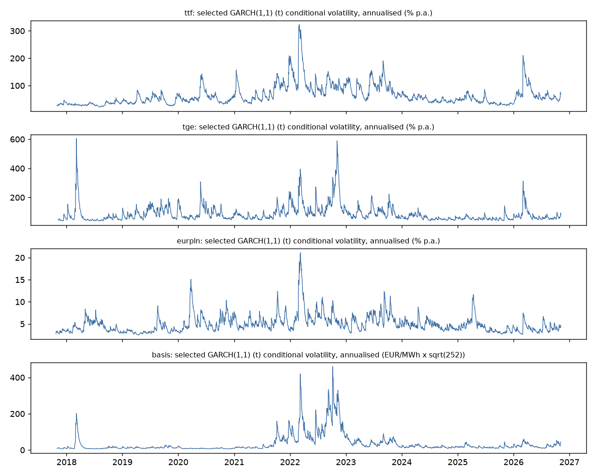

# Stage 4 - Volatility report

Generated by `python -m gasrisk.volatility`. Every number and verdict is computed; nothing is typed by hand.

## Design

- **Series:** TTF (roll-adjusted, two excluded roll days dropped), TGE, EUR/PLN (ECB) as percent log returns;
  the location plus tenor basis (TGE day-ahead spot minus TTF second month) as daily changes in EUR/MWh.
- **Mean equation:** candidates constant, ar1, ar2, ar5, ar10, dow, ar2_dow, ar5_dow, ar10_dow (AR lags and/or day-of-week
  dummies), fitted with GARCH(1,1)-t. Rule: keep the constant mean if its standardised residuals pass Ljung-Box
  at lags [5, 10, 20] (p >= 0.05); otherwise the lowest-BIC candidate that passes. Stage 5 filtered historical
  simulation resamples these standardised residuals, so they must be serially uncorrelated.
- **Innovations:** normal and Student-t for every series, plus basis: skewt;
  chosen by BIC and by two-sided tail calibration at 1% (share of residuals below the fitted 1% quantile and above
  the 99% quantile, both expected at 0.0100).
- **Out-of-sample:** rolling 750-day window, re-estimation every 21 trading days, daily filter
  updates; cumulative variance forecasts at h = [1, 5, 21] account for the AR mean. Benchmarks: EWMA
  (lambda 0.94) and a 63-day rolling variance. Realised variance proxy: summed squared
  returns; MSE and QLIKE losses (Patton 2011); DM vs ewma (HAC h-1 lags, HLN) with Holm adjustment.

## 1. Selected specification

| series | mean | mean_lags | mean_dow | dist | mean_reason | dist_reason | mean_selected_on_first_window | same_on_first_window |
|---|---|---|---|---|---|---|---|---|
| ttf | ar5 | [1, 2, 3, 4, 5] | False | t | lowest BIC among candidates passing Ljung-Box at all lags | best on both BIC and two-sided 1% tail calibration | ar5 | True |
| tge | ar10_dow | [1, 2, 3, 4, 5, 6, 7, 8, 9, 10] | True | t | lowest BIC among candidates passing Ljung-Box at all lags | best on both BIC and two-sided 1% tail calibration | ar10_dow | True |
| eurpln | constant | [] | False | t | constant mean passes Ljung-Box at all lags | best on both BIC and two-sided 1% tail calibration | ar1 | False |
| basis | ar5_dow | [1, 2, 3, 4, 5] | True | t | lowest BIC among candidates passing Ljung-Box at all lags | best on both BIC and two-sided 1% tail calibration | ar5_dow | True |

## 2. Mean equation and residual autocorrelation

Ljung-Box p-values on GARCH-t standardised residuals before (constant mean), with AR(1), and after selection:

| series | model | selected | lb_z_p5 | lb_z_p10 | lb_z_p20 | bic |
|---|---|---|---|---|---|---|
| basis | AR(1) |  | 0.0000 | 0.0000 | 0.0000 | 8184.6578 |
| basis | constant mean (before) |  | 0.0000 | 0.0000 | 0.0000 | 8450.8529 |
| basis | selected (after) | ar5_dow | 0.6948 | 0.5709 | 0.7100 | 7895.9741 |
| eurpln | AR(1) |  | 0.2268 | 0.0654 | 0.2565 | 762.7521 |
| eurpln | constant mean (before) |  | 0.2217 | 0.0616 | 0.2533 | 758.4562 |
| eurpln | selected (after) | constant | 0.2217 | 0.0616 | 0.2533 | 758.4562 |
| tge | AR(1) |  | 0.0023 | 0.0000 | 0.0000 | 13817.0554 |
| tge | constant mean (before) |  | 0.0030 | 0.0000 | 0.0000 | 13814.3333 |
| tge | selected (after) | ar10_dow | 0.4411 | 0.8344 | 0.2450 | 13710.3951 |
| ttf | AR(1) |  | 0.0080 | 0.0170 | 0.0047 | 12468.9098 |
| ttf | constant mean (before) |  | 0.0015 | 0.0039 | 0.0010 | 12465.3889 |
| ttf | selected (after) | ar5 | 0.8672 | 0.5927 | 0.1225 | 12474.5896 |

- **ttf**: selected mean **ar5** (lowest BIC among candidates passing Ljung-Box at all lags). Ljung-Box p on standardised residuals at lags 5, 10, 20: constant mean 0.0015, 0.0039, 0.0010; AR(1) 0.0080, 0.0170, 0.0047 (does not pass); selected 0.8672, 0.5927, 0.1225. Selection on the first training window only: ar5 (same).
- **tge**: selected mean **ar10_dow** (lowest BIC among candidates passing Ljung-Box at all lags). Ljung-Box p on standardised residuals at lags 5, 10, 20: constant mean 0.0030, 0.0000, 0.0000; AR(1) 0.0023, 0.0000, 0.0000 (does not pass); selected 0.4411, 0.8344, 0.2450. Selection on the first training window only: ar10_dow (same).
- **eurpln**: selected mean **constant** (constant mean passes Ljung-Box at all lags). Ljung-Box p on standardised residuals at lags 5, 10, 20: constant mean 0.2217, 0.0616, 0.2533; AR(1) 0.2268, 0.0654, 0.2565 (passes); selected 0.2217, 0.0616, 0.2533. Selection on the first training window only: ar1 (different).
- **basis**: selected mean **ar5_dow** (lowest BIC among candidates passing Ljung-Box at all lags). Ljung-Box p on standardised residuals at lags 5, 10, 20: constant mean 0.0000, 0.0000, 0.0000; AR(1) 0.0000, 0.0000, 0.0000 (does not pass); selected 0.6948, 0.5709, 0.7100. Selection on the first training window only: ar5_dow (same).

All candidates (GARCH-t):

| series | mean | bic | lb_z_p5 | lb_z_p10 | lb_z_p20 | lb_passes | selected | selection_reason | ar_coefs |
|---|---|---|---|---|---|---|---|---|---|
| ttf | constant | 12465.3889 | 0.0015 | 0.0039 | 0.0010 | False | False |  |  |
| ttf | ar1 | 12468.9098 | 0.0080 | 0.0170 | 0.0047 | False | False |  | 0.030 |
| ttf | ar2 | 12472.1197 | 0.0145 | 0.0261 | 0.0057 | False | False |  | 0.031, -0.029 |
| ttf | ar5 | 12474.5896 | 0.8672 | 0.5927 | 0.1225 | True | True | lowest BIC among candidates passing Ljung-Box at all lags | 0.034, -0.025, -0.015, 0.070, -0.027 |
| ttf | ar10 | 12489.8769 | 0.9022 | 0.9977 | 0.5450 | True | False |  | 0.033, -0.026, -0.015, 0.072, -0.027, 0.032, 0.040, 0.009, 0.011, -0.016 |
| ttf | dow | 12491.9653 | 0.0010 | 0.0027 | 0.0008 | False | False |  |  |
| ttf | ar2_dow | 12498.2135 | 0.0113 | 0.0207 | 0.0049 | False | False |  | 0.033, -0.029 |
| ttf | ar5_dow | 12499.4397 | 0.8688 | 0.5667 | 0.1204 | True | False |  | 0.036, -0.026, -0.015, 0.072, -0.030 |
| ttf | ar10_dow | 12514.2927 | 0.9063 | 0.9979 | 0.5590 | True | False |  | 0.036, -0.027, -0.016, 0.074, -0.031, 0.034, 0.039, 0.007, 0.014, -0.019 |
| tge | constant | 13814.3333 | 0.0030 | 0.0000 | 0.0000 | False | False |  |  |
| tge | ar1 | 13817.0554 | 0.0023 | 0.0000 | 0.0000 | False | False |  | -0.019 |
| tge | ar2 | 13817.0003 | 0.0065 | 0.0000 | 0.0000 | False | False |  | -0.020, -0.038 |
| tge | ar5 | 13804.6578 | 0.5594 | 0.0036 | 0.0000 | False | False |  | -0.024, -0.036, -0.020, -0.015, 0.083 |
| tge | ar10 | 13781.0686 | 0.4686 | 0.8278 | 0.0039 | False | False |  | -0.016, -0.040, -0.027, -0.010, 0.084, -0.032, 0.028, 0.031, -0.031, 0.059 |
| tge | dow | 13713.4666 | 0.1280 | 0.0443 | 0.0044 | False | False |  |  |
| tge | ar2_dow | 13718.1371 | 0.2175 | 0.0813 | 0.0093 | False | False |  | -0.008, -0.035 |
| tge | ar5_dow | 13721.8472 | 0.5127 | 0.1708 | 0.0302 | False | False |  | -0.009, -0.034, -0.018, 0.003, 0.036 |
| tge | ar10_dow | 13710.3951 | 0.4411 | 0.8344 | 0.2450 | True | True | lowest BIC among candidates passing Ljung-Box at all lags | -0.005, -0.036, -0.021, 0.004, 0.040, -0.019, 0.029, 0.034, -0.020, 0.025 |
| eurpln | constant | 758.4562 | 0.2217 | 0.0616 | 0.2533 | True | True | constant mean passes Ljung-Box at all lags |  |
| eurpln | ar1 | 762.7521 | 0.2268 | 0.0654 | 0.2565 | True | False |  | -0.000 |
| eurpln | ar2 | 771.3473 | 0.2168 | 0.0588 | 0.2380 | True | False |  | 0.001, -0.016 |
| eurpln | ar5 | 795.1040 | 0.4092 | 0.1057 | 0.3504 | True | False |  | 0.001, -0.015, 0.003, 0.008, 0.021 |
| eurpln | ar10 | 830.4843 | 0.4471 | 0.8549 | 0.9154 | True | False |  | 0.003, -0.017, 0.006, 0.005, 0.021, -0.034, 0.009, -0.030, -0.011, -0.038 |
| eurpln | dow | 782.9312 | 0.2258 | 0.0604 | 0.2313 | True | False |  |  |
| eurpln | ar2_dow | 795.9875 | 0.2299 | 0.0599 | 0.2213 | True | False |  | 0.003, -0.016 |
| eurpln | ar5_dow | 820.3693 | 0.4240 | 0.1068 | 0.3279 | True | False |  | 0.002, -0.015, 0.004, 0.009, 0.018 |
| eurpln | ar10_dow | 854.9857 | 0.4586 | 0.8596 | 0.8997 | True | False |  | 0.004, -0.018, 0.006, 0.006, 0.018, -0.033, 0.009, -0.030, -0.010, -0.041 |
| basis | constant | 8450.8529 | 0.0000 | 0.0000 | 0.0000 | False | False |  |  |
| basis | ar1 | 8184.6578 | 0.0000 | 0.0000 | 0.0000 | False | False |  | -0.355 |
| basis | ar2 | 8074.2533 | 0.0000 | 0.0000 | 0.0000 | False | False |  | -0.441, -0.227 |
| basis | ar5 | 8010.3708 | 0.8066 | 0.3413 | 0.0175 | False | False |  | -0.500, -0.338, -0.209, -0.139, -0.024 |
| basis | ar10 | 8018.4420 | 0.8902 | 0.9905 | 0.1897 | True | False |  | -0.501, -0.345, -0.225, -0.159, -0.059, -0.055, -0.039, -0.035, -0.060, 0.002 |
| basis | dow | 8302.9995 | 0.0000 | 0.0000 | 0.0000 | False | False |  |  |
| basis | ar2_dow | 7933.2245 | 0.0000 | 0.0001 | 0.0017 | False | False |  | -0.442, -0.217 |
| basis | ar5_dow | 7895.9741 | 0.6948 | 0.5709 | 0.7100 | True | True | lowest BIC among candidates passing Ljung-Box at all lags | -0.488, -0.309, -0.180, -0.108, -0.056 |
| basis | ar10_dow | 7908.3025 | 0.7970 | 0.9723 | 0.9311 | True | False |  | -0.492, -0.319, -0.196, -0.134, -0.095, -0.067, -0.033, -0.018, -0.038, -0.027 |

## 3. Innovation distribution

| series | mean | dist | n | loglik | aic | bic | ar_coefs | alpha | beta | nu | skew_lambda | persistence | near_integrated | half_life_days |
|---|---|---|---|---|---|---|---|---|---|---|---|---|---|---|
| ttf | ar5 | normal | 2314 | -6252.0265 | 12522.0530 | 12573.7736 | 0.034, -0.013, -0.013, 0.058, -0.063 | 0.1263 | 0.8737 |  |  | 1.0000 | True |  |
| ttf | ar5 | t | 2314 | -6198.5611 | 12417.1223 | 12474.5896 | 0.034, -0.025, -0.015, 0.070, -0.027 | 0.1328 | 0.8664 | 8.1201 |  | 0.9992 | True |  |
| tge | ar10_dow | normal | 2310 | -6914.2680 | 13864.5360 | 13967.9461 | -0.030, -0.062, -0.055, 0.000, 0.019, -0.014, 0.008, 0.051, -0.016, 0.026 | 0.2295 | 0.7471 |  |  | 0.9766 | False | 29.3168 |
| tge | ar10_dow | t | 2310 | -6781.6200 | 13601.2401 | 13710.3951 | -0.005, -0.036, -0.021, 0.004, 0.040, -0.019, 0.029, 0.034, -0.020, 0.025 | 0.2141 | 0.7779 | 4.3228 |  | 0.9921 | False | 87.0904 |
| eurpln | constant | normal | 2320 | -440.6854 | 889.3708 | 912.3680 |  | 0.1043 | 0.8868 |  |  | 0.9911 | False | 77.9034 |
| eurpln | constant | t | 2320 | -359.8548 | 729.7096 | 758.4562 |  | 0.1399 | 0.8388 | 5.1608 |  | 0.9787 | False | 32.2537 |
| basis | ar5_dow | normal | 2313 | -4042.5823 | 8111.1645 | 8185.8664 | -0.500, -0.339, -0.199, -0.145, -0.056 | 0.1962 | 0.8038 |  |  | 1.0000 | True |  |
| basis | ar5_dow | t | 2313 | -3893.7630 | 7815.5259 | 7895.9741 | -0.488, -0.309, -0.180, -0.108, -0.056 | 0.2048 | 0.7952 | 4.8437 |  | 1.0000 | True |  |
| basis | ar5_dow | skewt | 2313 | -3891.2870 | 7812.5739 | 7898.7684 | -0.492, -0.314, -0.185, -0.110, -0.059 | 0.2072 | 0.7928 | 4.8561 | -0.0594 | 1.0000 | True |  |

Standardised residual diagnostics (selected mean equation):

| series | mean | dist | lb_z_p5 | lb_z_p10 | lb_z_p20 | lb_z2_p10 | arch_lm_z_p5 | z_excess_kurtosis | pit_ks_p | share_below_q01 | share_below_q05 | share_above_q95 | share_above_q99 | calib_error_1pct |
|---|---|---|---|---|---|---|---|---|---|---|---|---|---|---|
| ttf | ar5 | normal | 0.3124 | 0.2396 | 0.0309 | 0.9889 | 0.9789 | 3.1354 | 0.0970 | 0.0151 | 0.0449 | 0.0475 | 0.0134 | 0.0085 |
| ttf | ar5 | t | 0.8672 | 0.5927 | 0.1225 | 0.9929 | 0.9870 | 3.5160 | 0.9280 | 0.0086 | 0.0480 | 0.0497 | 0.0099 | 0.0014 |
| tge | ar10_dow | normal | 0.0557 | 0.2335 | 0.0587 | 0.8511 | 0.5310 | 3.8758 | 0.0000 | 0.0156 | 0.0450 | 0.0411 | 0.0139 | 0.0094 |
| tge | ar10_dow | t | 0.4411 | 0.8344 | 0.2450 | 0.7416 | 0.4124 | 4.2967 | 0.7152 | 0.0104 | 0.0502 | 0.0485 | 0.0091 | 0.0013 |
| eurpln | constant | normal | 0.2200 | 0.0667 | 0.2933 | 0.2245 | 0.2586 | 2.3870 | 0.0025 | 0.0112 | 0.0392 | 0.0530 | 0.0233 | 0.0145 |
| eurpln | constant | t | 0.2217 | 0.0616 | 0.2533 | 0.7023 | 0.8306 | 2.6496 | 0.6095 | 0.0069 | 0.0440 | 0.0582 | 0.0138 | 0.0069 |
| basis | ar5_dow | normal | 0.3399 | 0.2943 | 0.5156 | 0.7921 | 0.3815 | 5.0527 | 0.0000 | 0.0190 | 0.0502 | 0.0450 | 0.0177 | 0.0167 |
| basis | ar5_dow | t | 0.6948 | 0.5709 | 0.7100 | 0.9579 | 0.7560 | 5.9167 | 0.5946 | 0.0147 | 0.0610 | 0.0493 | 0.0099 | 0.0048 |
| basis | ar5_dow | skewt | 0.7364 | 0.5793 | 0.7152 | 0.9583 | 0.7571 | 5.8197 | 0.8614 | 0.0134 | 0.0579 | 0.0540 | 0.0134 | 0.0068 |

- **ttf**: selected **t** (best on both BIC and two-sided 1% tail calibration). normal: BIC 12573.8, below 1% 0.0151, above 99% 0.0134; t: BIC 12474.6, below 1% 0.0086, above 99% 0.0099.
- **tge**: selected **t** (best on both BIC and two-sided 1% tail calibration). normal: BIC 13967.9, below 1% 0.0156, above 99% 0.0139; t: BIC 13710.4, below 1% 0.0104, above 99% 0.0091.
- **eurpln**: selected **t** (best on both BIC and two-sided 1% tail calibration). normal: BIC 912.4, below 1% 0.0112, above 99% 0.0233; t: BIC 758.5, below 1% 0.0069, above 99% 0.0138.
- **basis**: selected **t** (best on both BIC and two-sided 1% tail calibration). normal: BIC 8185.9, below 1% 0.0190, above 99% 0.0177; t: BIC 7896.0, below 1% 0.0147, above 99% 0.0099; skewt: BIC 7898.8, below 1% 0.0134, above 99% 0.0134.

Persistence of the selected models:

- ttf: persistence 0.9992, **near-integrated** (at or above 0.999): shocks barely decay and a half-life is not meaningful; the model behaves much like EWMA.
- tge: persistence 0.9921, half-life 87.1 days.
- eurpln: persistence 0.9787, half-life 32.3 days.
- basis: persistence 1.0000, **near-integrated** (at or above 0.999): shocks barely decay and a half-life is not meaningful; the model behaves much like EWMA.

## 4. Out-of-sample volatility forecasts

Test window:

| series | h | first_origin | last_origin | n |
|---|---|---|---|---|
| basis | 1 | 2020-09-29 00:00:00 | 2026-11-05 00:00:00 | 1567 |
| basis | 5 | 2020-09-29 00:00:00 | 2026-10-30 00:00:00 | 1563 |
| basis | 21 | 2020-09-29 00:00:00 | 2026-10-08 00:00:00 | 1547 |
| eurpln | 1 | 2020-09-29 00:00:00 | 2026-11-05 00:00:00 | 1569 |
| eurpln | 5 | 2020-09-29 00:00:00 | 2026-10-30 00:00:00 | 1565 |
| eurpln | 21 | 2020-09-29 00:00:00 | 2026-10-08 00:00:00 | 1549 |
| tge | 1 | 2020-09-29 00:00:00 | 2026-11-05 00:00:00 | 1569 |
| tge | 5 | 2020-09-29 00:00:00 | 2026-10-30 00:00:00 | 1565 |
| tge | 21 | 2020-09-29 00:00:00 | 2026-10-08 00:00:00 | 1549 |
| ttf | 1 | 2020-09-28 00:00:00 | 2026-11-05 00:00:00 | 1568 |
| ttf | 5 | 2020-09-28 00:00:00 | 2026-10-30 00:00:00 | 1564 |
| ttf | 21 | 2020-09-28 00:00:00 | 2026-10-08 00:00:00 | 1548 |

| series | h | model | n | qlike | qlike_diff_vs_bench | dm_p_qlike | holm_p_qlike | mse_ratio_vs_bench | dm_p_mse | verdict_qlike |
|---|---|---|---|---|---|---|---|---|---|---|
| basis | 1 | garch_normal | 1567 | 2.5808 | -0.0595 | 0.0307 | 1.0000 | 0.9329 | 0.0837 | better (raw only) |
| basis | 1 | garch_t | 1567 | 2.5702 | -0.0701 | 0.0253 | 0.9112 | 0.9132 | 0.0834 | better (raw only) |
| basis | 1 | garch_skewt | 1567 | 2.5691 | -0.0712 | 0.0242 | 0.8970 | 0.9134 | 0.0838 | better (raw only) |
| basis | 1 | ewma | 1567 | 2.6403 | 0.0000 |  |  | 1.0000 |  | benchmark |
| basis | 1 | rolling | 1567 | 2.8010 | 0.1607 | 0.9999 | 1.0000 | 1.0712 | 0.9804 | not better |
| basis | 5 | garch_normal | 1563 | 6.4124 | 2.0566 | 1.0000 | 1.0000 | 1.0562 | 0.7072 | not better |
| basis | 5 | garch_t | 1563 | 6.3494 | 1.9936 | 1.0000 | 1.0000 | 1.0448 | 0.6731 | not better |
| basis | 5 | garch_skewt | 1563 | 6.3561 | 2.0004 | 1.0000 | 1.0000 | 1.0446 | 0.6726 | not better |
| basis | 5 | ewma | 1563 | 4.3558 | 0.0000 |  |  | 1.0000 |  | benchmark |
| basis | 5 | rolling | 1563 | 4.4840 | 0.1283 | 0.9842 | 1.0000 | 1.0741 | 0.8617 | not better |
| basis | 21 | garch_normal | 1547 | 11.9128 | 5.8429 | 0.9976 | 1.0000 | 1.0798 | 0.5965 | not better |
| basis | 21 | garch_t | 1547 | 11.6859 | 5.6161 | 0.9968 | 1.0000 | 1.0651 | 0.5810 | not better |
| basis | 21 | garch_skewt | 1547 | 11.7226 | 5.6528 | 0.9967 | 1.0000 | 1.0646 | 0.5805 | not better |
| basis | 21 | ewma | 1547 | 6.0698 | 0.0000 |  |  | 1.0000 |  | benchmark |
| basis | 21 | rolling | 1547 | 6.1268 | 0.0570 | 0.7271 | 1.0000 | 1.0787 | 0.6421 | not better |
| eurpln | 1 | garch_normal | 1569 | -1.2394 | -0.0014 | 0.4701 | 1.0000 | 0.9638 | 0.2174 | not better |
| eurpln | 1 | garch_t | 1569 | -1.2360 | 0.0020 | 0.5347 | 1.0000 | 0.9576 | 0.2243 | not better |
| eurpln | 1 | ewma | 1569 | -1.2380 | 0.0000 |  |  | 1.0000 |  | benchmark |
| eurpln | 1 | rolling | 1569 | -1.1743 | 0.0637 | 0.9993 | 1.0000 | 1.0864 | 0.9832 | not better |
| eurpln | 5 | garch_normal | 1565 | 0.4129 | -0.0121 | 0.3177 | 1.0000 | 0.9076 | 0.2540 | not better |
| eurpln | 5 | garch_t | 1565 | 0.4156 | -0.0094 | 0.3786 | 1.0000 | 0.8239 | 0.1019 | not better |
| eurpln | 5 | ewma | 1565 | 0.4250 | 0.0000 |  |  | 1.0000 |  | benchmark |
| eurpln | 5 | rolling | 1565 | 0.4548 | 0.0298 | 0.8188 | 1.0000 | 1.1749 | 0.8568 | not better |
| eurpln | 21 | garch_normal | 1549 | 1.9064 | -0.0278 | 0.2646 | 1.0000 | 1.1028 | 0.8488 | not better |
| eurpln | 21 | garch_t | 1549 | 1.9124 | -0.0217 | 0.3334 | 1.0000 | 0.8248 | 0.1601 | not better |
| eurpln | 21 | ewma | 1549 | 1.9341 | 0.0000 |  |  | 1.0000 |  | benchmark |
| eurpln | 21 | rolling | 1549 | 1.9384 | 0.0043 | 0.5570 | 1.0000 | 0.9860 | 0.4648 | not better |
| tge | 1 | garch_normal | 1569 | 4.2062 | -0.0518 | 0.0143 | 0.5442 | 1.0300 | 0.5718 | better (raw only) |
| tge | 1 | garch_t | 1569 | 4.1999 | -0.0581 | 0.0051 | 0.1990 | 0.9460 | 0.2985 | better (raw only) |
| tge | 1 | ewma | 1569 | 4.2580 | 0.0000 |  |  | 1.0000 |  | benchmark |
| tge | 1 | rolling | 1569 | 4.3662 | 0.1082 | 0.9992 | 1.0000 | 1.1584 | 0.9985 | not better |
| tge | 5 | garch_normal | 1565 | 5.9315 | -0.0076 | 0.4182 | 1.0000 | 0.9944 | 0.4908 | not better |
| tge | 5 | garch_t | 1565 | 5.9043 | -0.0348 | 0.1408 | 1.0000 | 0.8702 | 0.2045 | not better |
| tge | 5 | ewma | 1565 | 5.9391 | 0.0000 |  |  | 1.0000 |  | benchmark |
| tge | 5 | rolling | 1565 | 6.0327 | 0.0936 | 0.9787 | 1.0000 | 1.2830 | 0.9373 | not better |
| tge | 21 | garch_normal | 1549 | 7.5935 | 0.0888 | 0.8946 | 1.0000 | 1.3858 | 0.8291 | not better |
| tge | 21 | garch_t | 1549 | 7.5443 | 0.0396 | 0.7567 | 1.0000 | 0.9489 | 0.2871 | not better |
| tge | 21 | ewma | 1549 | 7.5047 | 0.0000 |  |  | 1.0000 |  | benchmark |
| tge | 21 | rolling | 1549 | 7.5734 | 0.0687 | 0.8581 | 1.0000 | 1.1292 | 0.7156 | not better |
| ttf | 1 | garch_normal | 1568 | 3.9522 | 0.0022 | 0.5575 | 1.0000 | 0.9553 | 0.2038 | not better |
| ttf | 1 | garch_t | 1568 | 3.9523 | 0.0023 | 0.5617 | 1.0000 | 0.9527 | 0.1797 | not better |
| ttf | 1 | ewma | 1568 | 3.9500 | 0.0000 |  |  | 1.0000 |  | benchmark |
| ttf | 1 | rolling | 1568 | 4.0395 | 0.0895 | 1.0000 | 1.0000 | 1.0541 | 0.9745 | not better |
| ttf | 5 | garch_normal | 1564 | 5.6322 | 0.0143 | 0.7483 | 1.0000 | 1.0124 | 0.6115 | not better |
| ttf | 5 | garch_t | 1564 | 5.6273 | 0.0095 | 0.6835 | 1.0000 | 1.0089 | 0.5821 | not better |
| ttf | 5 | ewma | 1564 | 5.6178 | 0.0000 |  |  | 1.0000 |  | benchmark |
| ttf | 5 | rolling | 1564 | 5.6913 | 0.0734 | 0.9891 | 1.0000 | 1.0645 | 0.7904 | not better |
| ttf | 21 | garch_normal | 1548 | 7.2488 | 0.0777 | 0.9303 | 1.0000 | 1.3125 | 0.9336 | not better |
| ttf | 21 | garch_t | 1548 | 7.2333 | 0.0621 | 0.9078 | 1.0000 | 1.3318 | 0.9182 | not better |
| ttf | 21 | ewma | 1548 | 7.1711 | 0.0000 |  |  | 1.0000 |  | benchmark |
| ttf | 21 | rolling | 1548 | 7.2294 | 0.0582 | 0.8472 | 1.0000 | 0.8988 | 0.3045 | not better |

`qlike_diff_vs_bench` below zero means lower (better) QLIKE than ewma; `mse_ratio_vs_bench` below one means lower MSE.

- basis, h=1: lowest QLIKE **garch_skewt**; better than ewma after Holm: none; raw only: garch_normal, garch_t, garch_skewt.
- basis, h=5: lowest QLIKE **ewma**; better than ewma after Holm: none.
- basis, h=21: lowest QLIKE **ewma**; better than ewma after Holm: none.
- eurpln, h=1: lowest QLIKE **garch_normal**; better than ewma after Holm: none.
- eurpln, h=5: lowest QLIKE **garch_normal**; better than ewma after Holm: none.
- eurpln, h=21: lowest QLIKE **garch_normal**; better than ewma after Holm: none.
- tge, h=1: lowest QLIKE **garch_t**; better than ewma after Holm: none; raw only: garch_normal, garch_t.
- tge, h=5: lowest QLIKE **garch_t**; better than ewma after Holm: none.
- tge, h=21: lowest QLIKE **ewma**; better than ewma after Holm: none.
- ttf, h=1: lowest QLIKE **ewma**; better than ewma after Holm: none.
- ttf, h=5: lowest QLIKE **ewma**; better than ewma after Holm: none.
- ttf, h=21: lowest QLIKE **ewma**; better than ewma after Holm: none.

### Mincer-Zarnowitz (h = 1): realised = a + b x forecast

| series | model | mz_a | mz_b | mz_b_se | mz_b_eq_1_p | mz_r2 |
|---|---|---|---|---|---|---|
| basis | garch_normal | 6.1626 | 0.9857 | 0.2586 | 0.9559 | 0.1808 |
| basis | garch_t | 5.8378 | 0.9939 | 0.2519 | 0.9808 | 0.1980 |
| basis | garch_skewt | 5.8441 | 0.9934 | 0.2519 | 0.9792 | 0.1978 |
| basis | ewma | 4.2628 | 0.8474 | 0.1973 | 0.4392 | 0.1244 |
| basis | rolling | 8.0766 | 0.7099 | 0.1624 | 0.0741 | 0.0694 |
| eurpln | garch_normal | 0.0205 | 0.7632 | 0.1770 | 0.1808 | 0.1251 |
| eurpln | garch_t | 0.0194 | 0.7754 | 0.1343 | 0.0944 | 0.1295 |
| eurpln | ewma | 0.0256 | 0.7940 | 0.2573 | 0.4233 | 0.0842 |
| eurpln | rolling | 0.0632 | 0.4937 | 0.1832 | 0.0057 | 0.0215 |
| tge | garch_normal | 14.4304 | 0.6412 | 0.1388 | 0.0097 | 0.2106 |
| tge | garch_t | 9.0519 | 0.7679 | 0.1423 | 0.1028 | 0.2359 |
| tge | ewma | 4.6730 | 0.8870 | 0.2678 | 0.6731 | 0.1722 |
| tge | rolling | 16.2231 | 0.6167 | 0.2442 | 0.1165 | 0.0618 |
| ttf | garch_normal | 4.2963 | 0.7852 | 0.1131 | 0.0575 | 0.1526 |
| ttf | garch_t | 4.1459 | 0.8057 | 0.1159 | 0.0937 | 0.1520 |
| ttf | ewma | 4.8569 | 0.8245 | 0.2083 | 0.3994 | 0.1051 |
| ttf | rolling | 7.5876 | 0.7240 | 0.2343 | 0.2388 | 0.0604 |

An unbiased, efficient forecast has a = 0 and b = 1. Squared daily returns are a noisy proxy, so low R^2 is
expected even for a good model; the slope is the informative part.

## 5. Implications for VaR (Stage 5)

- In-sample tail calibration of the selected models (expected 0.0100 in each tail):
  ttf (t) below 1% 0.0086, above 99% 0.0099, tge (t) below 1% 0.0104, above 99% 0.0091, eurpln (t) below 1% 0.0069, above 99% 0.0138, basis (t) below 1% 0.0147, above 99% 0.0099.
- Out-of-sample GARCH at h=1 relative to ewma: basis garch_normal QLIKE diff -0.0595, basis garch_t QLIKE diff -0.0701, basis garch_skewt QLIKE diff -0.0712, eurpln garch_normal QLIKE diff -0.0014, eurpln garch_t QLIKE diff +0.0020, tge garch_normal QLIKE diff -0.0518, tge garch_t QLIKE diff -0.0581, ttf garch_normal QLIKE diff +0.0022, ttf garch_t QLIKE diff +0.0023.
- Stage 5 uses the selected mean equation and distribution for GARCH VaR, the selected model's standardised
  residuals for filtered historical simulation, and EWMA (never beaten out of sample) as a separate VaR method.

## Limitations

- Realised variance is proxied by squared daily returns; intraday data would give a sharper proxy.
- Symmetric GARCH(1,1) only; leverage or inverse-leverage effects (GJR, EGARCH) are not modelled.
- The mean equation is selected on the full sample; the first-window check above shows whether the same choice
  would have been made without future data.
- Persistence at or near one is also what unmodelled structural breaks (such as the 2021-2022 crisis regime)
  produce; a regime-switching or break-adjusted GARCH is out of scope.
- The basis is a location plus tenor basis whose large moves come mainly from TGE spot spikes (Stage 2).
