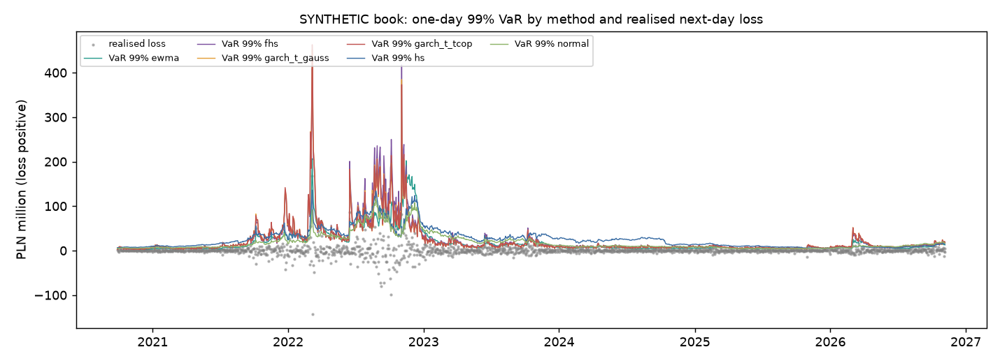

# Stage 5 - VaR and Expected Shortfall report

Generated by `python -m gasrisk.var`. Every number is computed; nothing is typed by hand. All P&L, VaR and ES
figures refer to a **SYNTHETIC book** and are in PLN, loss positive.

## Book (synthetic)

| position | size |
|---|---|
| short floating TGE (open purchases) | 500,000 MWh |
| long TTF futures | 0.7 x open volume |
| long EUR/PLN forward | EUR notional = 0.7 x open volume x TGE in EUR, rebalanced daily |

Risk factors: TGE in EUR (TGEgasDA PLN / ECB EUR/PLN), TTF second month held to roll, EUR/PLN (ECB). Each
scenario is fully revalued: TGE leg -Q x (TGE_EUR' x FX' - TGE_EUR x FX), TTF leg N x (TTF' - TTF) x FX', FX leg
N_fx x (FX' - FX). Without a TGE forward curve, unhedged future purchases are valued at today's TGE day-ahead price
(see the location plus tenor basis limitation).

## Methods

| method | description |
|---|---|
| hs | historical simulation, last 500 joint daily returns |
| normal | multivariate normal, mean and covariance of the last 250 returns, Monte Carlo |
| garch_t_gauss | Stage 4 selected GARCH(1,1)-t per factor (TGE in EUR uses TGE's specification), Gaussian copula |
| garch_t_tcop | same marginals, Student-t copula with degrees of freedom by maximum likelihood (tail dependence) |
| fhs | filtered historical simulation: joint standardised residuals x tomorrow's volatility + mean |
| ewma | RiskMetrics EWMA covariance (lambda 0.94), multivariate normal, Monte Carlo |

GARCH parameters, correlation and copula df are re-estimated every 21 trading days on 750
observations; filters update daily. Monte Carlo: 20000 draws per day, seed fixed per origin. VaR at
[0.95, 0.99], ES at [0.95, 0.975, 0.99] (97.5% ES is the Basel FRTB measure).

## Today

| as_of | method | var_95 | var_99 | es_95 | es_97.5 | es_99 |
|---|---|---|---|---|---|---|
| 2026-11-06 | hs | 8,593,989 | 14,059,283 | 14,642,277 | 18,908,801 | 29,242,699 |
| 2026-11-06 | normal | 11,677,916 | 16,552,844 | 14,729,468 | 16,803,615 | 19,363,909 |
| 2026-11-06 | garch_t_gauss | 11,250,052 | 18,323,060 | 15,937,774 | 19,328,415 | 24,459,174 |
| 2026-11-06 | garch_t_tcop | 11,146,189 | 18,485,457 | 16,044,738 | 19,582,239 | 25,013,776 |
| 2026-11-06 | fhs | 10,688,090 | 17,084,202 | 14,608,366 | 17,378,039 | 20,938,570 |
| 2026-11-06 | ewma | 9,049,796 | 12,795,287 | 11,469,251 | 13,055,902 | 14,916,202 |

Highest 97.5% ES today: **garch_t_tcop** (19,582,239 PLN); lowest: **ewma** (13,055,902 PLN).

## Over the test window

| method | origins | mean_var_95 | mean_var_99 | mean_es_95 | mean_es_97.5 | mean_es_99 | mean_var_99_pre_crisis | mean_var_99_crisis | mean_var_99_post_crisis |
|---|---|---|---|---|---|---|---|---|---|
| hs | 1571 | 10,921,161 | 25,871,210 | 20,790,059 | 27,525,057 | 37,397,034 | 10,025,515 | 48,012,121 | 16,135,412 |
| normal | 1571 | 12,663,059 | 18,317,514 | 16,143,688 | 18,457,999 | 21,274,201 | 6,677,662 | 36,343,778 | 10,106,530 |
| garch_t_gauss | 1571 | 13,502,995 | 22,428,919 | 19,565,408 | 24,047,409 | 31,171,686 | 5,594,497 | 50,070,660 | 9,609,266 |
| garch_t_tcop | 1571 | 13,480,840 | 22,551,876 | 19,588,606 | 24,085,771 | 31,118,765 | 5,592,979 | 50,299,177 | 9,696,844 |
| fhs | 1571 | 13,793,766 | 23,812,476 | 20,289,524 | 24,815,669 | 31,265,414 | 5,182,939 | 54,295,867 | 9,689,473 |
| ewma | 1571 | 12,768,436 | 18,672,052 | 16,406,667 | 18,834,003 | 21,806,527 | 4,045,385 | 41,905,587 | 8,004,419 |

## Gaussian vs Student-t copula

The Gaussian copula has no tail dependence, so it understates the chance that TGE, TTF and EUR/PLN move to
extremes together. Ratio of t-copula to Gaussian-copula risk (same GARCH-t marginals):

| measure | mean_ratio_tcop_over_gauss | median_ratio | share_days_tcop_higher | mean_ratio_pre_crisis | mean_ratio_crisis | mean_ratio_post_crisis |
|---|---|---|---|---|---|---|
| var_99 | 1.0075 | 1.0081 | 0.6003 | 0.9998 | 1.0052 | 1.0106 |
| es_97.5 | 1.0092 | 1.0063 | 0.5971 | 1.0275 | 1.0030 | 1.0088 |
| es_99 | 1.0122 | 1.0068 | 0.5621 | 1.0474 | 1.0023 | 1.0101 |

| copula_df_median | copula_df_min | copula_df_max | share_refits_df_le_10 | corr_tge_ttf_median |
|---|---|---|---|---|
| 20.0000 | 8.0000 | 50.0000 | 0.2857 | 0.4706 |

On average the t copula gives 1.009x the Gaussian-copula 97.5% ES and
1.007x the 99% VaR. Because the book is hedged (short TGE, long TTF),
joint extremes in the same direction partly offset; the copula effect on the book is therefore smaller than on an
unhedged position and can go either way.

## Realised next-day P&L of the synthetic book (test window)

| days | mean_pnl | sd_pnl | min_pnl | max_pnl | sd_tge_leg | sd_ttf_leg | sd_fx_leg | corr_tge_ttf_legs |
|---|---|---|---|---|---|---|---|---|
| 1568 | -78,366.29 | 12,146,864.13 | -167,412,106.64 | 143,658,755.86 | 15,835,597.45 | 8,918,712.79 | 546,036.77 | -0.63 |

## Limitations

- Positions are synthetic and static in MWh; the EUR forward notional is rebalanced daily.
- Unhedged future purchases are valued at TGE day-ahead (no TGE forward curve), so basis risk mixes location and tenor.
- One-day horizon only; liquidity horizons beyond one day are not modelled.
- The two TTF roll days excluded in Stage 1 have no realised P&L and are left out of backtests.
