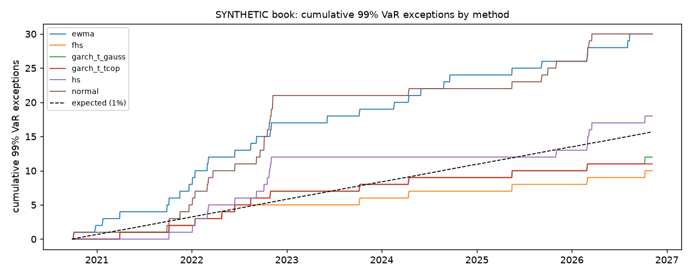

# Stage 6 - VaR backtesting report

Generated by `python -m gasrisk.backtest` from the Stage 5 walk-forward forecasts. Every number and verdict is
computed. The book is **synthetic**; losses are in PLN.

Backtest sample: 1568 days per method, targets 2020-09-29 to 2026-11-06
(the two TTF roll days excluded in Stage 1 have no realised P&L). An exception is a realised loss above the VaR
forecast made the day before.

## Exceptions, Kupiec and Christoffersen

Kupiec POF (H0: exception rate = 1 - level, chi-square 1 df); Christoffersen independence (H0: exceptions not
clustered, `n11` = consecutive exceptions) and conditional coverage (both, chi-square 2 df); pass at p >= 0.05.

| method | level | n | expected | observed | rate | lr_pof | p_pof | n11 | lr_ind | p_ind | lr_cc | p_cc | pass_pof | pass_ind | pass_cc |
|---|---|---|---|---|---|---|---|---|---|---|---|---|---|---|---|
| hs | 0.9500 | 1568 | 78.4000 | 66 | 0.0421 | 2.1766 | 0.1401 | 6 | 3.1331 | 0.0767 | 5.3097 | 0.0703 | True | True | True |
| hs | 0.9900 | 1568 | 15.6800 | 18 | 0.0115 | 0.3310 | 0.5651 | 1 | 1.6381 | 0.2006 | 1.9690 | 0.3736 | True | True | True |
| normal | 0.9500 | 1568 | 78.4000 | 57 | 0.0364 | 6.7659 | 0.0093 | 4 | 1.5430 | 0.2142 | 8.3089 | 0.0157 | False | True | False |
| normal | 0.9900 | 1568 | 15.6800 | 30 | 0.0191 | 10.4212 | 0.0012 | 3 | 5.4828 | 0.0192 | 15.9040 | 0.0004 | False | False | False |
| garch_t_gauss | 0.9500 | 1568 | 78.4000 | 60 | 0.0383 | 4.9288 | 0.0264 | 1 | 0.9443 | 0.3312 | 5.8732 | 0.0530 | False | True | True |
| garch_t_gauss | 0.9900 | 1568 | 15.6800 | 12 | 0.0077 | 0.9492 | 0.3299 | 0 | 0.1852 | 0.6669 | 1.1344 | 0.5671 | True | True | True |
| garch_t_tcop | 0.9500 | 1568 | 78.4000 | 58 | 0.0370 | 6.1179 | 0.0134 | 1 | 0.7714 | 0.3798 | 6.8893 | 0.0319 | False | True | False |
| garch_t_tcop | 0.9900 | 1568 | 15.6800 | 11 | 0.0070 | 1.5753 | 0.2094 | 0 | 0.1555 | 0.6933 | 1.7308 | 0.4209 | True | True | True |
| fhs | 0.9500 | 1568 | 78.4000 | 58 | 0.0370 | 6.1179 | 0.0134 | 1 | 0.7714 | 0.3798 | 6.8893 | 0.0319 | False | True | False |
| fhs | 0.9900 | 1568 | 15.6800 | 10 | 0.0064 | 2.3847 | 0.1225 | 0 | 0.1285 | 0.7200 | 2.5132 | 0.2846 | True | True | True |
| ewma | 0.9500 | 1568 | 78.4000 | 86 | 0.0548 | 0.7529 | 0.3856 | 3 | 0.7951 | 0.3726 | 1.5480 | 0.4612 | True | True | True |
| ewma | 0.9900 | 1568 | 15.6800 | 30 | 0.0191 | 10.4212 | 0.0012 | 1 | 0.2702 | 0.6032 | 10.6914 | 0.0048 | False | True | False |

- Methods passing conditional coverage at 95%: hs, garch_t_gauss, ewma; at 99%: hs, garch_t_gauss, garch_t_tcop, fhs.
- Methods passing conditional coverage at both levels: garch_t_gauss, hs.
- Closest exception count to expectation at 99%: **hs** (18 observed vs 15.7 expected).

## Basel traffic light (99% VaR, 250-day windows)

| method | latest_250d_exceptions | latest_zone | share_windows_green | share_windows_yellow | share_windows_red | max_250d_exceptions |
|---|---|---|---|---|---|---|
| hs | 5 | yellow | 0.5709 | 0.3942 | 0.0349 | 11 |
| normal | 4 | green | 0.5246 | 0.2411 | 0.2343 | 17 |
| garch_t_gauss | 2 | green | 0.9431 | 0.0569 | 0.0000 | 5 |
| garch_t_tcop | 1 | green | 0.9431 | 0.0569 | 0.0000 | 5 |
| fhs | 2 | green | 1.0000 | 0.0000 | 0.0000 | 4 |
| ewma | 4 | green | 0.5444 | 0.4117 | 0.0440 | 11 |

## Expected Shortfall check (descriptive)

On days the 99% VaR is exceeded, a correct 99% ES should on average equal the realised loss (ratio near 1;
above 1 means ES understates tail losses). This is descriptive, not a formal ES backtest.

| method | exceptions_99 | mean_loss_over_es99 | median_loss_over_es99 | share_loss_above_es99 |
|---|---|---|---|---|
| hs | 18 | 1.1126 | 0.9691 | 0.5000 |
| normal | 30 | 1.3741 | 1.1940 | 0.6667 |
| garch_t_gauss | 12 | 0.8831 | 0.8812 | 0.1667 |
| garch_t_tcop | 11 | 0.9067 | 0.9004 | 0.1818 |
| fhs | 10 | 0.9381 | 0.8995 | 0.2000 |
| ewma | 30 | 1.1756 | 1.0285 | 0.6000 |

## Exceptions by sub-period

| subperiod | method | n | exceptions_99 | expected_99 | exceptions_95 | expected_95 |
|---|---|---|---|---|---|---|
| pre_crisis | hs | 193 | 0 | 1.9300 | 2 | 9.6500 |
| pre_crisis | normal | 193 | 1 | 1.9300 | 3 | 9.6500 |
| pre_crisis | garch_t_gauss | 193 | 1 | 1.9300 | 9 | 9.6500 |
| pre_crisis | garch_t_tcop | 193 | 1 | 1.9300 | 7 | 9.6500 |
| pre_crisis | fhs | 193 | 1 | 1.9300 | 8 | 9.6500 |
| pre_crisis | ewma | 193 | 4 | 1.9300 | 11 | 9.6500 |
| crisis | hs | 516 | 12 | 5.1600 | 40 | 25.8000 |
| crisis | normal | 516 | 20 | 5.1600 | 29 | 25.8000 |
| crisis | garch_t_gauss | 516 | 6 | 5.1600 | 28 | 25.8000 |
| crisis | garch_t_tcop | 516 | 6 | 5.1600 | 28 | 25.8000 |
| crisis | fhs | 516 | 4 | 5.1600 | 27 | 25.8000 |
| crisis | ewma | 516 | 14 | 5.1600 | 39 | 25.8000 |
| post_crisis | hs | 859 | 6 | 8.5900 | 24 | 42.9500 |
| post_crisis | normal | 859 | 9 | 8.5900 | 25 | 42.9500 |
| post_crisis | garch_t_gauss | 859 | 5 | 8.5900 | 23 | 42.9500 |
| post_crisis | garch_t_tcop | 859 | 4 | 8.5900 | 23 | 42.9500 |
| post_crisis | fhs | 859 | 5 | 8.5900 | 23 | 42.9500 |
| post_crisis | ewma | 859 | 12 | 8.5900 | 36 | 42.9500 |

## Limitations

- Exceptions at 99% are rare (15 expected per method), so the tests have limited power,
  and six methods are tested at two levels without a multiple-testing adjustment (standard in VaR validation,
  but the chance that at least one method fails by luck is higher than 5%).
- Positions are synthetic and static in MWh.
