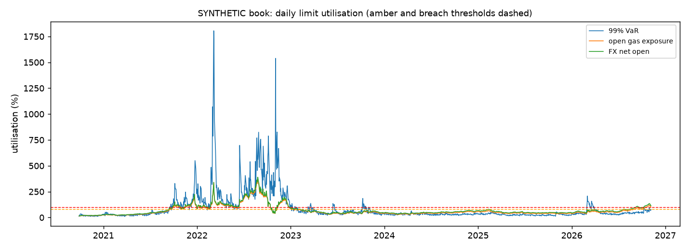

# Stage 7 - Limits and breach analysis report

Generated by `python -m gasrisk.limits`. Every number is computed. Book and limits are **synthetic**.

## Official VaR method

**garch_t_gauss**: passes conditional coverage at all levels (garch_t_gauss, hs); highest share of green 250-day windows among them (0.9431) (Stage 6 backtest).

## Limits (synthetic)

| limit | value | escalation |
|---|---|---|
| 99% one-day VaR | 25,000,000 PLN | amber from 80%, breach above 100% |
| open gas exposure (unhedged volume x TGE price in PLN) | 60,000,000 PLN | same |
| FX net open position (EUR value of TGE purchases not covered by the forward) | 12,000,000 EUR | same |

Limits are round management numbers relative to the synthetic book, not fitted to the backtest.

## Today (2026-11-06)

| limit | measure | limit_value | utilisation |
|---|---|---|---|
| 99% VaR (PLN) | 18,323,059.7400 | 25000000 | 0.7329 |
| open gas exposure (PLN) | 60,913,500.0000 | 60000000 | 1.0152 |
| FX net open position (EUR) | 13,867,615.2533 | 12000000 | 1.1556 |

Euler decomposition of today's official 99% VaR by risk factor (components sum to the VaR):

| factor | component_var99_pln | share |
|---|---|---|
| TGE price (EUR) | 16,688,156.6156 | 0.9108 |
| TTF price | 1,622,721.2493 | 0.0886 |
| EUR/PLN | 12,181.8751 | 0.0007 |

## Utilisation over the test window

| limit | days | mean_utilisation | max_utilisation | days_amber | days_breach | breach_episodes | latest_utilisation | latest_status |
|---|---|---|---|---|---|---|---|---|
| var_99 | 1571 | 0.8972 | 18.0516 | 63 | 341 | 33 | 0.7329 | green |
| open_gas | 1571 | 0.6595 | 3.7114 | 112 | 260 | 12 | 1.0152 | breach |
| fx_net_open | 1571 | 0.7307 | 3.9003 | 101 | 309 | 13 | 1.1556 | breach |

## Breach episodes and drivers

An episode is a run of consecutive breach days. VaR driver: the main contributor (largest Euler share of the
official VaR at the start) and the factor whose component rose most over the 20 trading days before the episode (`vol_ratio_*` = conditional volatility at start /
at the reference date). Exposure driver: exact split of the log change in utilisation since it was last below
amber into the TGE price and EUR/PLN parts.

| limit | start | end | days | peak_utilisation | reference_date | share_tge_eur_at_start | share_ttf_at_start | share_fx_at_start | vol_ratio_tge_eur | vol_ratio_ttf | vol_ratio_fx | main_contributor | driver |
|---|---|---|---|---|---|---|---|---|---|---|---|---|---|
| var_99 | 2021-09-17 | 2021-09-21 | 3 | 1.2952 | 2021-08-20 | 0.7452 | 0.2561 | -0.0013 | 1.1158 | 1.1135 | 1.1697 | TGE price (EUR) | TGE price (EUR) (share 75% at start); largest increase TGE price (EUR) (+6,919,151 PLN since reference date) |
| var_99 | 2021-09-24 | 2021-09-24 | 1 | 1.1176 | 2021-08-27 | 0.7186 | 0.2829 | -0.0015 | 1.0247 | 1.1872 | 1.7736 | TGE price (EUR) | TGE price (EUR) (share 72% at start); largest increase TGE price (EUR) (+7,359,620 PLN since reference date) |
| var_99 | 2021-09-28 | 2021-10-20 | 17 | 3.2941 | 2021-08-31 | 0.8902 | 0.1112 | -0.0014 | 1.5579 | 1.4319 | 0.9416 | TGE price (EUR) | TGE price (EUR) (share 89% at start); largest increase TGE price (EUR) (+19,884,084 PLN since reference date) |
| var_99 | 2021-10-22 | 2021-10-22 | 1 | 1.2616 | 2021-09-24 | 0.6831 | 0.3183 | -0.0015 | 0.9408 | 1.0261 | 1.0589 | TGE price (EUR) | TGE price (EUR) (share 68% at start); largest increase TTF price (+2,136,993 PLN since reference date) |
| var_99 | 2021-10-29 | 2021-11-03 | 4 | 1.4889 | 2021-10-01 | 0.8717 | 0.1295 | -0.0012 | 1.0388 | 0.8975 | 0.7549 | TGE price (EUR) | TGE price (EUR) (share 87% at start); largest increase EUR/PLN (+20,117 PLN since reference date) |
| var_99 | 2021-11-05 | 2021-11-05 | 1 | 1.0276 | 2021-10-08 | 0.7307 | 0.2705 | -0.0012 | 0.5345 | 0.6736 | 0.3995 | TGE price (EUR) | TGE price (EUR) (share 73% at start); largest increase EUR/PLN (+97,513 PLN since reference date) |
| var_99 | 2021-11-09 | 2021-12-01 | 17 | 2.4582 | 2021-10-12 | 0.6927 | 0.3084 | -0.0010 | 0.6368 | 0.9604 | 0.3949 | TGE price (EUR) | TGE price (EUR) (share 69% at start); largest increase TTF price (+2,748,018 PLN since reference date) |
| var_99 | 2021-12-03 | 2022-02-07 | 47 | 5.5045 | 2021-11-05 | 0.7184 | 0.2836 | -0.0020 | 0.7528 | 0.8288 | 1.6759 | TGE price (EUR) | TGE price (EUR) (share 72% at start); largest increase TGE price (EUR) (+4,481,796 PLN since reference date) |
| var_99 | 2022-02-09 | 2022-02-09 | 1 | 1.0002 | 2022-01-12 | 0.8716 | 0.1300 | -0.0016 | 0.8471 | 0.5810 | 1.3368 | TGE price (EUR) | TGE price (EUR) (share 87% at start); no component increased since the reference date (VaR was already elevated) |
| var_99 | 2022-02-14 | 2022-02-16 | 3 | 1.3398 | 2022-01-17 | 0.9252 | 0.0767 | -0.0018 | 0.5344 | 0.4667 | 1.6664 | TGE price (EUR) | TGE price (EUR) (share 93% at start); no component increased since the reference date (VaR was already elevated) |
| var_99 | 2022-02-18 | 2022-02-18 | 1 | 1.2737 | 2022-01-21 | 0.7685 | 0.2329 | -0.0014 | 0.7780 | 0.8210 | 1.8281 | TGE price (EUR) | TGE price (EUR) (share 77% at start); largest increase TTF price (+641,776 PLN since reference date) |
| var_99 | 2022-02-23 | 2022-04-22 | 41 | 18.0516 | 2022-01-26 | 0.7104 | 0.2906 | -0.0010 | 0.9416 | 0.9057 | 0.9278 | TGE price (EUR) | TGE price (EUR) (share 71% at start); largest increase EUR/PLN (+8,832 PLN since reference date) |
| var_99 | 2022-04-26 | 2022-05-25 | 22 | 2.3008 | 2022-03-25 | 0.5596 | 0.4412 | -0.0008 | 0.4452 | 0.5708 | 0.4782 | TGE price (EUR) | TGE price (EUR) (share 56% at start); largest increase EUR/PLN (+29,526 PLN since reference date) |
| var_99 | 2022-05-27 | 2022-05-27 | 1 | 1.0575 | 2022-04-29 | 0.7900 | 0.2101 | -0.0001 | 0.7175 | 0.8467 | 0.8088 | TGE price (EUR) | TGE price (EUR) (share 79% at start); largest increase TTF price (+2,190,405 PLN since reference date) |
| var_99 | 2022-06-01 | 2022-06-01 | 1 | 1.2874 | 2022-05-04 | 0.9021 | 0.0979 | -0.0000 | 1.1624 | 1.0577 | 0.9278 | TGE price (EUR) | TGE price (EUR) (share 90% at start); largest increase TGE price (EUR) (+2,178,534 PLN since reference date) |
| var_99 | 2022-06-03 | 2022-06-03 | 1 | 1.1482 | 2022-05-06 | 0.8640 | 0.1360 | -0.0000 | 0.9825 | 0.9644 | 0.6751 | TGE price (EUR) | TGE price (EUR) (share 86% at start); largest increase EUR/PLN (+18,103 PLN since reference date) |
| var_99 | 2022-06-10 | 2022-06-10 | 1 | 1.2123 | 2022-05-13 | 0.9256 | 0.0742 | 0.0002 | 0.6020 | 0.4754 | 0.8873 | TGE price (EUR) | TGE price (EUR) (share 93% at start); largest increase EUR/PLN (+38,696 PLN since reference date) |
| var_99 | 2022-06-14 | 2022-12-30 | 143 | 15.3860 | 2022-05-17 | 0.6175 | 0.3829 | -0.0005 | 0.9442 | 1.0009 | 1.0775 | TGE price (EUR) | TGE price (EUR) (share 62% at start); largest increase TTF price (+1,822,901 PLN since reference date) |
| var_99 | 2023-01-03 | 2023-01-03 | 1 | 1.1683 | 2022-12-05 | 0.7515 | 0.2479 | 0.0006 | 0.9838 | 1.5333 | 0.8021 | TGE price (EUR) | TGE price (EUR) (share 75% at start); largest increase TTF price (+8,381,195 PLN since reference date) |
| var_99 | 2023-01-06 | 2023-01-06 | 1 | 1.3544 | 2022-12-08 | 0.6974 | 0.3020 | 0.0005 | 1.2414 | 1.4400 | 1.1210 | TGE price (EUR) | TGE price (EUR) (share 70% at start); largest increase TTF price (+5,531,182 PLN since reference date) |
| var_99 | 2023-01-18 | 2023-01-18 | 1 | 1.0750 | 2022-12-20 | 0.8071 | 0.1923 | 0.0006 | 0.7465 | 1.1453 | 0.9388 | TGE price (EUR) | TGE price (EUR) (share 81% at start); largest increase TTF price (+5,128,481 PLN since reference date) |
| var_99 | 2023-01-24 | 2023-01-24 | 1 | 1.0020 | 2022-12-27 | 0.7076 | 0.2920 | 0.0004 | 0.7812 | 1.1863 | 0.6807 | TGE price (EUR) | TGE price (EUR) (share 71% at start); largest increase TTF price (+4,023,002 PLN since reference date) |
| var_99 | 2023-03-10 | 2023-03-10 | 1 | 1.0458 | 2023-02-10 | 0.7372 | 0.2622 | 0.0006 | 2.0753 | 2.3568 | 0.5930 | TGE price (EUR) | TGE price (EUR) (share 74% at start); largest increase TTF price (+5,428,082 PLN since reference date) |
| var_99 | 2023-03-20 | 2023-03-22 | 3 | 1.3680 | 2023-02-20 | 1.0797 | -0.0805 | 0.0008 | 2.4550 | 1.7128 | 0.6226 | TGE price (EUR) | TGE price (EUR) (share 108% at start); largest increase TGE price (EUR) (+18,830,538 PLN since reference date) |
| var_99 | 2023-06-15 | 2023-06-20 | 4 | 1.3483 | 2023-05-18 | 1.0476 | -0.0492 | 0.0016 | 2.8541 | 2.0309 | 0.8734 | TGE price (EUR) | TGE price (EUR) (share 105% at start); largest increase TGE price (EUR) (+29,142,921 PLN since reference date) |
| var_99 | 2023-10-09 | 2023-10-11 | 3 | 1.8459 | 2023-09-11 | 1.0931 | -0.0942 | 0.0011 | 2.7140 | 0.7793 | 0.5167 | TGE price (EUR) | TGE price (EUR) (share 109% at start); largest increase TGE price (EUR) (+44,131,501 PLN since reference date) |
| var_99 | 2023-10-13 | 2023-10-16 | 2 | 1.3281 | 2023-09-15 | 1.0018 | -0.0033 | 0.0016 | 2.7214 | 1.1582 | 0.9180 | TGE price (EUR) | TGE price (EUR) (share 100% at start); largest increase TGE price (EUR) (+30,962,531 PLN since reference date) |
| var_99 | 2023-10-18 | 2023-10-18 | 1 | 1.0415 | 2023-09-20 | 0.9600 | 0.0367 | 0.0034 | 2.2949 | 1.1193 | 1.6844 | TGE price (EUR) | TGE price (EUR) (share 96% at start); largest increase TGE price (EUR) (+22,295,268 PLN since reference date) |
| var_99 | 2023-10-20 | 2023-10-20 | 1 | 1.1049 | 2023-09-22 | 1.0397 | -0.0424 | 0.0027 | 1.9991 | 1.0818 | 1.0583 | TGE price (EUR) | TGE price (EUR) (share 104% at start); largest increase TGE price (EUR) (+21,349,914 PLN since reference date) |
| var_99 | 2026-03-02 | 2026-03-12 | 9 | 2.0745 | 2026-02-02 | 0.9335 | 0.0668 | -0.0003 | 2.4811 | 2.0456 | 0.9313 | TGE price (EUR) | TGE price (EUR) (share 93% at start); largest increase TGE price (EUR) (+23,117,496 PLN since reference date) |
| var_99 | 2026-03-17 | 2026-03-17 | 1 | 1.1035 | 2026-02-17 | 0.8160 | 0.1846 | -0.0006 | 2.6082 | 2.3037 | 1.7753 | TGE price (EUR) | TGE price (EUR) (share 82% at start); largest increase TGE price (EUR) (+16,377,696 PLN since reference date) |
| var_99 | 2026-03-19 | 2026-03-25 | 5 | 1.5768 | 2026-02-19 | 0.9346 | 0.0659 | -0.0005 | 2.6873 | 2.0517 | 1.8782 | TGE price (EUR) | TGE price (EUR) (share 93% at start); largest increase TGE price (EUR) (+28,584,676 PLN since reference date) |
| var_99 | 2026-03-27 | 2026-03-27 | 1 | 1.0916 | 2026-02-27 | 0.9243 | 0.0761 | -0.0004 | 1.7152 | 1.9476 | 1.8593 | TGE price (EUR) | TGE price (EUR) (share 92% at start); largest increase TGE price (EUR) (+16,251,807 PLN since reference date) |
| open_gas | 2021-09-30 | 2021-10-27 | 20 | 1.3980 | 2021-09-17 | 0.9770 |  | 0.0230 |  |  |  |  | TGE price (EUR) (98% of the utilisation increase since it was last below amber; EUR/PLN 2%) |
| open_gas | 2021-11-16 | 2021-12-30 | 33 | 2.0716 | 2021-11-10 | 0.9691 |  | 0.0309 |  |  |  |  | TGE price (EUR) (97% of the utilisation increase since it was last below amber; EUR/PLN 3%) |
| open_gas | 2022-01-04 | 2022-01-10 | 5 | 1.1032 | 2021-11-10 | 1.0346 |  | -0.0346 |  |  |  |  | TGE price (EUR) (103% of the utilisation increase since it was last below amber; EUR/PLN -3%) |
| open_gas | 2022-01-14 | 2022-01-14 | 1 | 1.0657 | 2021-11-10 | 1.0504 |  | -0.0504 |  |  |  |  | TGE price (EUR) (105% of the utilisation increase since it was last below amber; EUR/PLN -5%) |
| open_gas | 2022-01-24 | 2022-01-31 | 6 | 1.0950 | 2021-11-10 | 1.0440 |  | -0.0440 |  |  |  |  | TGE price (EUR) (104% of the utilisation increase since it was last below amber; EUR/PLN -4%) |
| open_gas | 2022-02-24 | 2022-05-09 | 51 | 3.3754 | 2022-02-16 | 0.9398 |  | 0.0602 |  |  |  |  | TGE price (EUR) (94% of the utilisation increase since it was last below amber; EUR/PLN 6%) |
| open_gas | 2022-05-12 | 2022-05-20 | 7 | 1.1730 | 2022-02-16 | 0.9060 |  | 0.0940 |  |  |  |  | TGE price (EUR) (91% of the utilisation increase since it was last below amber; EUR/PLN 9%) |
| open_gas | 2022-05-30 | 2022-05-31 | 2 | 1.0682 | 2022-02-16 | 0.9233 |  | 0.0767 |  |  |  |  | TGE price (EUR) (92% of the utilisation increase since it was last below amber; EUR/PLN 8%) |
| open_gas | 2022-06-14 | 2022-10-13 | 88 | 3.7114 | 2022-02-16 | 0.8724 |  | 0.1276 |  |  |  |  | TGE price (EUR) (87% of the utilisation increase since it was last below amber; EUR/PLN 13%) |
| open_gas | 2022-11-09 | 2022-11-10 | 2 | 1.1157 | 2022-11-07 | 0.9941 |  | 0.0059 |  |  |  |  | TGE price (EUR) (99% of the utilisation increase since it was last below amber; EUR/PLN 1%) |
| open_gas | 2022-11-14 | 2022-12-22 | 29 | 1.8481 | 2022-11-07 | 0.9988 |  | 0.0012 |  |  |  |  | TGE price (EUR) (100% of the utilisation increase since it was last below amber; EUR/PLN 0%) |
| open_gas | 2026-10-16 | 2026-11-06 | 16 | 1.1877 | 2026-09-30 | 0.9990 |  | 0.0010 |  |  |  |  | TGE price (EUR) (100% of the utilisation increase since it was last below amber; EUR/PLN 0%) |
| fx_net_open | 2021-09-28 | 2021-10-28 | 23 | 1.5220 | 2021-09-13 | 1.0000 |  | 0.0000 |  |  |  |  | TGE price (EUR) (100% of the utilisation increase since it was last below amber; EUR/PLN 0%) |
| fx_net_open | 2021-11-15 | 2021-12-30 | 34 | 2.2362 | 2021-09-13 | 1.0000 |  | 0.0000 |  |  |  |  | TGE price (EUR) (100% of the utilisation increase since it was last below amber; EUR/PLN 0%) |
| fx_net_open | 2022-01-04 | 2022-01-12 | 7 | 1.2093 | 2021-09-13 | 1.0000 |  | 0.0000 |  |  |  |  | TGE price (EUR) (100% of the utilisation increase since it was last below amber; EUR/PLN 0%) |
| fx_net_open | 2022-01-14 | 2022-01-18 | 3 | 1.1733 | 2021-09-13 | 1.0000 |  | 0.0000 |  |  |  |  | TGE price (EUR) (100% of the utilisation increase since it was last below amber; EUR/PLN 0%) |
| fx_net_open | 2022-01-21 | 2022-02-08 | 13 | 1.1997 | 2021-09-13 | 1.0000 |  | 0.0000 |  |  |  |  | TGE price (EUR) (100% of the utilisation increase since it was last below amber; EUR/PLN 0%) |
| fx_net_open | 2022-02-14 | 2022-02-14 | 1 | 1.0415 | 2021-09-13 | 1.0000 |  | 0.0000 |  |  |  |  | TGE price (EUR) (100% of the utilisation increase since it was last below amber; EUR/PLN 0%) |
| fx_net_open | 2022-02-22 | 2022-06-06 | 73 | 3.4077 | 2021-09-13 | 1.0000 |  | 0.0000 |  |  |  |  | TGE price (EUR) (100% of the utilisation increase since it was last below amber; EUR/PLN 0%) |
| fx_net_open | 2022-06-09 | 2022-10-14 | 92 | 3.9003 | 2021-09-13 | 1.0000 |  | 0.0000 |  |  |  |  | TGE price (EUR) (100% of the utilisation increase since it was last below amber; EUR/PLN 0%) |
| fx_net_open | 2022-11-09 | 2022-11-10 | 2 | 1.1867 | 2022-11-07 | 1.0000 |  | 0.0000 |  |  |  |  | TGE price (EUR) (100% of the utilisation increase since it was last below amber; EUR/PLN 0%) |
| fx_net_open | 2022-11-14 | 2022-12-27 | 31 | 1.9722 | 2022-11-07 | 1.0000 |  | 0.0000 |  |  |  |  | TGE price (EUR) (100% of the utilisation increase since it was last below amber; EUR/PLN 0%) |
| fx_net_open | 2022-12-29 | 2022-12-29 | 1 | 1.0106 | 2022-11-07 | 1.0000 |  | 0.0000 |  |  |  |  | TGE price (EUR) (100% of the utilisation increase since it was last below amber; EUR/PLN 0%) |
| fx_net_open | 2026-09-09 | 2026-09-18 | 8 | 1.0875 | 2026-08-14 | 1.0000 |  | 0.0000 |  |  |  |  | TGE price (EUR) (100% of the utilisation increase since it was last below amber; EUR/PLN 0%) |
| fx_net_open | 2026-10-09 | 2026-11-06 | 21 | 1.3485 | 2026-08-14 | 1.0000 |  | 0.0000 |  |  |  |  | TGE price (EUR) (100% of the utilisation increase since it was last below amber; EUR/PLN 0%) |

VaR breach episodes by main contributor: TGE price (EUR): 33.

## Method notes and limitations

- Euler components use linear sensitivities with the official method's GARCH volatilities and copula
  correlations and are rescaled to the official (fully revalued) VaR; for large moves the linear split is an
  approximation.
- Exposure limits are value-based, so they bind when prices rise even with unchanged volumes.
- Positions are synthetic and static in MWh; breaches here are market driven by construction.
