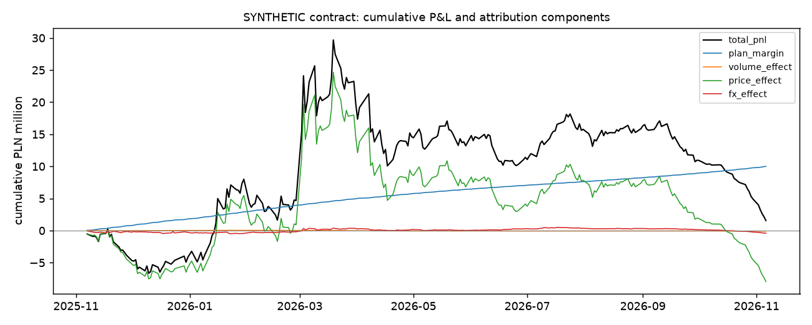

# Stage 9 - P&L attribution report

Generated by `python -m gasrisk.attribution`. Every number is computed. Contract, volumes and hedges are **synthetic**;
prices are TGE (trade date, in EUR via ECB EUR/PLN), TTF second month held to roll and ECB EUR/PLN.

## Contract (synthetic)

| contract_start | contract_end | delivery_days | contracted_mwh | actual_mwh | volume_deviation | sale_margin_pln_mwh | max_abs_daily_residual |
|---|---|---|---|---|---|---|---|
| 2025-11-07 | 2026-11-06 | 256 | 500,000.0000 | 495,742.0247 | -0.0085 | 20.0000 | 0.0000 |

Contracted volumes follow a winter-peak profile summing to 500,000 MWh; actual volumes deviate
by a synthetic AR(1) demand factor. Fixed sale price = plan cost (TGE x EUR/PLN at signing) + 20.0
PLN/MWh. TTF futures (70%) and the EUR forward (70%) are sized on the
remaining contracted volume. Deliveries are booked on panel trading days at the TGE trade-date price (simplification).

## Decomposition

Daily P&L = V (S - G F) + N_ttf dTTF F + N_fx dF, split sequentially and exactly:

| component | formula |
|---|---|
| plan margin | C (S - P0 F0) |
| volume effect | (V - C)(S - P0 F0) |
| price effect | -V (G - P0) F0 + N_ttf dTTF F0 |
| FX effect | -V G (F - F0) + N_ttf dTTF (F - F0) + N_fx dF |

The four components sum to the daily P&L with a maximum absolute residual of 9.313e-10 PLN
(enforced in code and by `tests/test_attribution.py`).

## Contract-to-date totals

| component | pln |
|---|---|
| total_pnl | 1,565,811 |
| plan_margin | 10,000,000 |
| volume_effect | -85,160 |
| price_effect | -7,936,717 |
| fx_effect | -412,312 |
| price_effect_purchase | -38,096,776 |
| price_effect_hedge | 30,160,059 |
| fx_effect_purchase | -909,308 |
| fx_effect_hedge_translation | 285,632 |
| fx_effect_forward | 211,363 |

Total P&L 1,565,811 PLN against a plan margin of 10,000,000 PLN; the largest deviation from plan is the
**price effect** (-7,936,717 PLN). Within the price effect, purchases contribute -38,096,776 PLN and
the TTF hedge +30,160,059 PLN.

## Monthly

| month | total_pnl | plan_margin | volume_effect | price_effect | fx_effect | reconciles |
|---|---|---|---|---|---|---|
| 2025-11 | -3,814,474 | 746,287 | -8,755 | -4,417,337 | -134,669 | True |
| 2025-12 | -320,573 | 1,067,992 | 29,442 | -1,269,894 | -148,113 | True |
| 2026-01 | 12,139,159 | 1,109,325 | 14,094 | 11,165,710 | -149,970 | True |
| 2026-02 | -3,323,743 | 1,020,339 | -15,440 | -4,578,128 | 249,487 | True |
| 2026-03 | 15,174,240 | 1,016,710 | -44,290 | 13,691,529 | 510,292 | True |
| 2026-04 | -5,234,767 | 782,516 | -31,639 | -5,817,544 | -168,099 | True |
| 2026-05 | -1,408,441 | 685,581 | 8,113 | -1,963,213 | -138,922 | True |
| 2026-06 | -1,807,870 | 607,892 | -19,127 | -2,673,349 | 276,715 | True |
| 2026-07 | 4,362,962 | 590,659 | 10,552 | 3,702,808 | 58,943 | True |
| 2026-08 | 102,786 | 577,331 | 11,288 | -452,958 | -32,875 | True |
| 2026-09 | -4,918,598 | 713,189 | -2,037 | -5,446,746 | -183,003 | True |
| 2026-10 | -6,016,993 | 863,864 | -47,783 | -6,466,124 | -366,950 | True |
| 2026-11 | -3,367,878 | 218,316 | 10,423 | -3,411,470 | -185,147 | True |

## Limitations

- Contract, demand and hedge sizes are synthetic; the plan cost uses the TGE day-ahead price at signing because
  no TGE forward curve is available.
- Weekend deliveries are folded into trading days; the hedge is rebalanced daily to the remaining volume.
- This realised, delivery-based view differs from the Stage 5 risk view, which holds a constant open volume.
